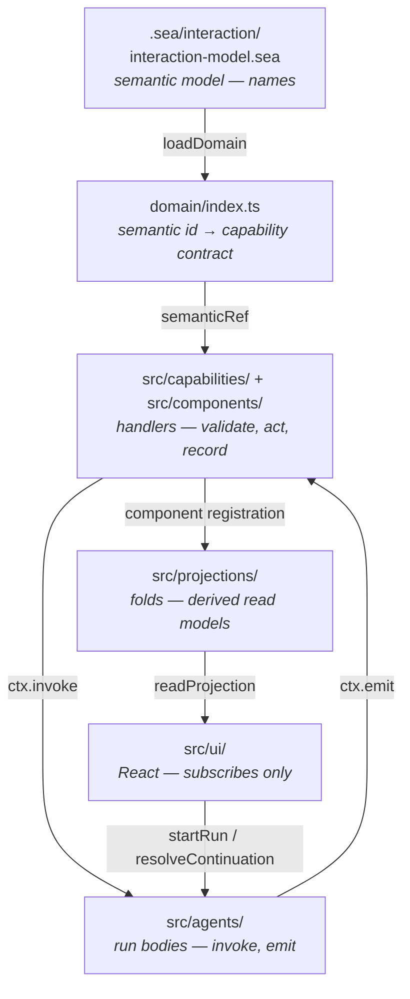
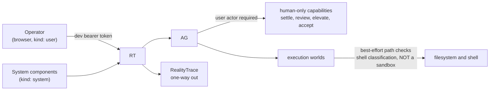

# Architecture

The canonical high-level architectural model. Read this before changing anything. Subsystem detail
lives under [subsystems/](subsystems/), execution detail under [workflows/](workflows/), and the
"why" under [explanation/](explanation/).

## Logical architecture

Six layers. The dependency direction between them is strict and is the single most useful thing to
internalise.



Two islands sit underneath and are imported *by* the layers above, never the reverse:

- `src/workbench/*` and `src/cognitive/*` — pure, deterministic, no I/O. `src/domain/*.ts` holds the
  two pure gates.
- `src/store.ts`, `src/settings.ts`, `src/secrets.ts`, `src/observations.ts`, `src/workDetails.ts`
  — small support modules with no Cognate dependency of their own beyond types.

Rules that hold in the current code and should stay true:

1. A pure domain module imports nothing from `capabilities`, `agents`, `projections`, or `ui`.
2. A capability handler validates before it acts, and never keeps state between invocations.
3. A projection is a pure function of `(event, priorState)`.
4. The UI imports no server-only module except value helpers from `src/cognitive/`
   (`shortHash`, `parseRef`, `validateSurface`).

## Runtime architecture

There is one process. Not "a server and a worker" — one.

`src/server.ts` → `startServer()` performs, in order:

1. Create the home directory; build the store config; open the secret store.
2. `loadDomain()` — parse the `.sea` file via DomainForge, log object count and digest, fail fast on
   a parse error.
3. Bind every capability tranche to its semantic ref, each with a count assertion.
4. `createRuntime({ store, outboxFor, policy, actions, components, projections, agents })`.
5. `runtime.kernel.mount(...)` each component group.
6. Remount the last-configured model provider from the `model-config` projection. This is required,
   not cosmetic: a run resumed after a restart needs a live provider to call `model.generate`.
7. If an SXR binary resolves, wire RealityTrace delivery. Otherwise log a warning and leave
   observations queued. Mount the read-side observation component either way.
8. Start a background fold loop tracking known workspace ids.
9. Build the Connect router in-process and mount the UI bundle and CSS.

Then `Bun.serve` on `127.0.0.1` with `PORT` (default `3180`).

Why it is shaped this way — including why not `cognate dev`, and why the API is not a second
proxied server — is in [Why one Bun process](explanation/why-single-bun-process.md).

### HTTP surface

| Path | Serves |
|---|---|
| `GET /health` | `{ ok: true, semantic: { objects, digest } }` |
| `/cognate.v1.RuntimeService/*` | Connect RPC |
| `GET /app.js` | bundled browser JavaScript |
| `GET /app.css` | `src/ui/app.css` plus the concatenated workbench sheets |
| `GET /astryx.css`, `GET /theme.css` | Astryx stylesheets |
| `GET /` | inline HTML shell |

`.generated/entry.tsx` is written at boot and rebuilt with `Bun.build` on every start. It is a
generated artifact, not source.

## Dependency architecture

### App dependencies on the framework

| Package | Used for |
|---|---|
| `cognate-runtime-bun`, `cognate-runtime-api` | runtime, kernel, runs, continuations, `Caller` |
| `cognate-kernel-api` | `Component`, `CapabilityContract`, `SemanticRef`, `CapabilityLease` |
| `cognate-events` | `StoredEvent`, `Json`, `DurableStore`, `OutboxIntent` |
| `cognate-projections` | the `Projection` interface |
| `cognate-capabilities` | `ModelProvider`, `ModelMessage`, `ToolDefinition`, `modelContract` |
| `cognate-domainforge` | parsing the `.sea` model |
| `cognate-execution`, `-ssh`, `-wsl` | `filesystem.*`, `process.exec` across worlds |
| `cognate-provider-*` | OpenAI-compatible, OpenAI Responses, Anthropic-compatible, auth |
| `cognate-protocol-connect`, `-bun` | Connect server and client transport, dev token |
| `cognate-client`, `cognate-react` | browser-side service client and hooks |
| `cognate-ui-astryx` | stylesheet paths served at `/astryx.css` and `/theme.css` |
| `cognate-realitytrace` | observation port and delivery |
| `cognate-store-postgres` | PostgreSQL store |

The app imports the published SDK only. `AGENTS.md` forbids importing the framework monorepo source,
vendored tarballs, or workspace aliases, and `test/skill-bundle.test.ts` guards it.

### Who calls whom

```
UI            ──startRun/resolveContinuation──▶  runtime
runtime       ────────────────────────────────▶  agents
agents        ──ctx.invoke──▶ capabilities ──▶  execution worlds / providers / secrets
capabilities  ──service.startRun──▶ agent.config  ──ctx.emit──▶  event log
event log     ──fold──▶ projections ──readProjection──▶  UI
capabilities  ──ctx.invoke──▶ other capabilities  (e.g. tool.edit → authority.check)
```

The second-to-last line is worth noting: capabilities invoke *other* capabilities through the same
governed path, rather than calling each other's functions.

## Data architecture

### What is recorded

The event log. Every domain change appends to it. Event names are namespaced by subsystem:

| Prefix | Produced by |
|---|---|
| `session.*` | `agent.coding`, the sessions projection |
| `message.*` | `agent.coding` (`message.completed`) |
| `tool.call.*` | `agent.coding` (`started`, `completed`, `failed`) |
| `plan.*` | `agent.coding` and `plan.state` |
| `model.configured` | `model.configure` |
| `workspace.*` | `workspace.select` / `workspace.manage` |
| `execution.world.*` | `execution.world.*` capabilities |
| `settings.changed` | the ten `settings.change*` capabilities |
| `onboarding.dismissed` | `onboarding.dismiss` |
| `subagent.spawned` | `agent.coding` after `subagent.start` returns |
| `workbench.*` | the 23 workbench capabilities via `agent.config` |
| `case.*`, `criterion.*`, `world.*`, `verification.*`, `sentinel.*`, `experiment.*`, `method.*` | the cognitive capabilities |

Full enumeration in [Event catalog](reference/event-catalog.md).

### What is derived

Eleven projections. `workbench` is the cockpit's one view; `sessions`, `plans`, `subagents`,
`session-trace`, `model-config`, `settings`, `workspaces`, `execution-worlds`, `onboarding`, and
`cognitive` each own one read model. Enumerated in
[Projection catalog](reference/projection-catalog.md).

### What is deliberately not in the log

Secrets. API keys and SSH passphrases live in `<home>/secrets.json` and never enter an event
payload. Durable execution-world records carry only the auth *kind*, a key *path*, and a pinned
host-key fingerprint.

Observation delivery receipts also stay out: they live in the DurableStore `observations`
collection, which is why the read side is two unrecorded capabilities rather than a projection.

## Control flow

The runtime orchestrates. Components provide capabilities. Agents call them. Nothing in the app
starts a run except a capability handler or the UI.

The one inversion worth naming: **writes start runs**. A capability handler validates, then calls
`service.startRun` for `agent.config`, which emits the event. There is no direct append. The
rationale and the consequences are in
[Why `agent.config` is the write path](explanation/why-agent-config-is-the-write-path.md).

Experts and Teams use another native Cognate write contract: `updateSharedState` appends
`state.changed` to the versioned `experts:registry` thread. Each capability revalidates the command
against the latest snapshot and commits with `expectedVersion`; conflicts re-read and revalidate.
This preserves atomic membership invariants and logical idempotency under concurrent mutations.
The `experts` projection derives the public roster and work view; scoped memory and private context
stay outside that projection. PostgreSQL remains the only persistence engine.

`agent.expert` reuses the coding engine with a frozen Assignment, model route and tool ceiling.
The completion bridge correlates genuine Cognate child runs and resolves native parent waits from
persisted terminal events. Expert side effects use native commitments, with ambiguous outcomes
reserved for human reconciliation. [Experts and Teams](experts-and-teams.md) explains these
contracts and their limits.

## Trust and security boundaries



Boundaries that hold:

- **Human-only decisions are structural.** `world.settle` and `method.accept` throw when
  `ctx.runId` is set. `task.review.decide` and `authority.elevate` require a `user` actor. An agent
  run invokes capabilities as a non-user principal, so it cannot accept its own work.
- **Authority is enforced before effect, not by prompt.** `authority.check` runs inside the tool
  loop before `tool.edit` or `tool.bash`.
- **Lower trust cannot lower approval.** Sentinel compares against a re-run of the chain at or
  above its own tier.
- **What is *not* here.** No OS-level sandbox. Path containment and shell classification are
  best-effort. Single-operator development authentication. All recorded in
  [Known gaps](known-gaps.md).

## Testing and verification

Tests are named after the journey they establish, which is why the suite reads like a requirements
list. `just smoke` runs three fast pure-domain tests. `just verify` typechecks then runs everything.
CI runs the same sequence against a `postgres:18` service. See
[Test layout](reference/test-layout.md).

## Source trail

- `src/server.ts` — `startServer()`, `GRANTED_CAPABILITIES`, `LOCAL_OPERATOR`, `SYSTEM_CALLER`,
  `BROWSER_ENTRY_TEMPLATE`, `buildPolicy`, `buildActionPolicy`, `Bun.serve`
- `src/store.ts` — `schemaFor`, `postgresUrl`, `storeConfigFor`
- `domain/index.ts` — `tranche5Bindings` … `bindUsage3`, `bindWorkbench`, `bindExecutionWorlds`
- `src/agents/agentCoding.ts`, `src/agents/agentConfig.ts`, `src/agents/agentCognitive.ts`
- `src/capabilities/` — one file per capability family
- `src/projections/` — event-derived read models, including `experts` and `provider-routes`
- `src/experts/` — typed identity/Assignment state, CAS mutation boundary, service governance and completion bridge
- `src/capabilities/expertModel.ts`, `expertEffect.ts` — isolated model routing and native commitment guards
- `src/agents/agentExpert.ts` — trusted wrapper around the existing coding engine
- `src/workbench/types.ts`, `src/cognitive/world.ts` — the two type roots
- `justfile`, `package.json`, `.github/workflows/verify.yml` — the command surface
