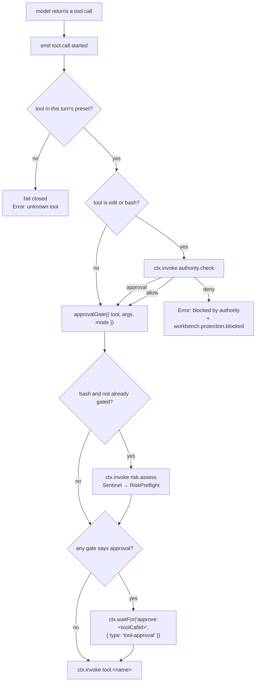

# Concept: authority and approval

This page is the canonical explanation of how Workbench decides what an agent may do, and of the
three separate mechanisms that can say no. Read it before touching the tool loop.

## Three gates, not one

The single most common misreading is that there is one "approval gate". There are three, they run
in a specific order, and each can independently stop a call.



## Gate 1 — the agent preset

The composer sends a preset per turn: `standard`, `ptc`, or `minimal`. A call for a tool outside the
preset fails closed with `Error: unknown tool "<name>"`. A run with no preset keeps the full catalog,
so direct API callers and older tests are unaffected.

This gate exists because a model can hallucinate a tool call. Failing closed on an unknown name is
cheaper than a defensive check downstream.

## Gate 2 — the authority plane

For `edit` and `bash`, `authority.check` is invoked before the tool runs. It consults the app-wide
and task-level protected-evidence rules and the task's authority scopes, and returns
`allow` / `approval` / `deny` with a rule name and a reason.

Outcomes are ordered `allow < approval < deny` and the strictest result wins across every rule
consulted, so adding a rule can only tighten the outcome, never loosen it.

A `deny` with a `protected-evidence` rule emits `workbench.protection.blocked` carrying the path and
the pattern that matched. The tool result fed back to the model is
`Error: blocked by authority (<rule>): <reason>`, and the loop continues — a refusal is information
to the agent, not a crash.

An `approval` verdict upgrades the decision: if `approvalGate` would not have required approval,
`agent.coding` synthesises a decision with `permission: "workspace-write"` for `edit`,
`permission: "shell"` for `bash`, and the justification "the task contract requires approval for
this operation".

**This is structural enforcement.** It runs inside the tool loop before the capability, not as
prompt prose the model is asked to respect. `test/workbench-authority-bypass.test.ts` guards it.

## Gate 3 — the approval gate proper

`approvalGate({ tool, args, mode })` in `src/domain/approvalGate.ts` is a pure function. It requires
approval exactly when:

- the tool is `run_code`, **and**
- its `sandbox_permissions` string ranks above the session's current access mode.

Ranking is `read-only < workspace-write < full-access`. An unrecognised permission or mode ranks
above every known one — fail-closed.

`read`, `edit` and `bash` never trigger this gate directly. They never carry `sandbox_permissions`
in their schemas.

The access mode defaults to `read-only` when absent — the conservative choice. The composer's
access-mode dropdown **is** wired: its value reaches `agent.coding` as `AgentCodingInput.mode`, which
feeds this function, and the `sessions` projection folds the mode the turn carried so the selection
reads back. The resolution order for a send is: the per-session override, else the pending
hero-composer choice when the session is being created, else the `permission` setting.

## Gate 4 — risk assessment for destructive shell

When a `bash` call has not already been gated, `risk.assess` runs it through a mediation chain:
Sentinel (governance tier) above RiskPreflight above any extra mediators. RiskPreflight classifies
the destructive-command family, derives an impact (target, file count, uncommitted changes, recovery
text) and composes a `preflight` Surface.

If authority is needed, the preflight Surface rides the same durable approval continuation as any
other gate.

Sentinel intervenes only for declared invariants:

- lower tiers cannot weaken human approval,
- agents cannot synthesise approval,
- mediators cannot gain undeclared capability,
- protected evidence is immutable,
- irreversible actions cannot skip preflight or recovery.

It does this by comparing its input against `next.trusted` — a re-run of the chain at or above its
own tier against a shadow core with no side effects.

## The durable wait

When any gate says approval, the run does not sleep. It parks:

```ts
ctx.waitFor(`approve:${toolCallId}`, {
  type: "tool-approval",
  condition: { kind: "human_approval" },
  payload: { tool, args, permission, justification },
});
```

The UI resolves it with `client.resolveContinuation(continuationId, "resume", { approved })`.
`Enter` is the affirmative action, `Escape` the negative one.

On denial the tool result fed back to the model is `approvalDeniedToolResult` — fixed wording, so
the model's next step is predictable.

**The run stays `waiting` across reload *and* across a full process restart.** That is deliberate and
differs from the reference product this app was reconstructed from, which silently finalised such
turns after a restart. See [Restart and recovery](../workflows/restart-and-recovery.md).

## Human-only decisions

Some capabilities refuse any caller that is not a human:

| Capability | Rule |
|---|---|
| `task.review.decide` | requires a `user` actor |
| `authority.elevate` | requires a `user` actor |
| `world.settle` | throws if `ctx.runId` is set; requires a `user` actor |
| `method.accept` | throws if `ctx.runId` is set; requires a `user` actor |

Agent runs invoke capabilities as a non-user principal, so an agent cannot accept its own work, settle
its own candidate, or raise its own authority.

## What authority is *not*

- It is not an OS sandbox. Path containment is workspace-relative normalisation; shell analysis is
  best-effort classification of a command family.
- It is not a prompt. Nothing in this chain depends on the model agreeing to it.
- It is not complete. `shellSafety.ts` classifies specific families; a command outside them is
  unclassified, which is *not* the same as safe — the surrounding gate treats unknown conservatively,
  but that is a policy decision, not a guarantee.

## Source trail

- `src/domain/approvalGate.ts` — `approvalGate`, `ApprovalDecisionRequest`, `ApprovalGateDecision`,
  `PERMISSION_RANK`, `approvalDeniedToolResult`
- `src/agents/agentCoding.ts` — the tool loop: preset check, `authority.check`, `approvalGate`,
  `risk.assess`, `ctx.waitFor`
- `src/workbench/authority.ts` — `decideWrite`, `decideShell`, `normalizeRelative`, `Decision`,
  the `allow < approval < deny` ordering
- `src/workbench/glob.ts` — protection pattern matching
- `src/workbench/shellSafety.ts` — command classification
- `src/cognitive/sentinel.ts` — the declared invariants
- `src/cognitive/preflight.ts` — `classifyDestructive`, `composePreflight`, `Impact`
- `src/capabilities/workbench.ts` — the human-only capability check
- `src/capabilities/cognitive.ts` — the `ctx.runId` guards
- `src/workbench/types.ts` — `AuthorityScopes`, `Grant`, `ProtectedPaths`
- `test/J-D-approval.test.ts`, `test/workbench-authority.test.ts`,
  `test/workbench-authority-bypass.test.ts`, `test/J-WB-protected-evidence.test.ts`,
  `test/workbench-shellsafety.test.ts`