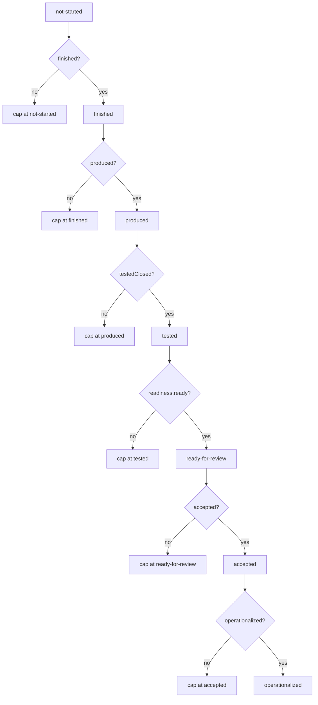

# Concept: evidence and done

Workbench refuses to collapse completion into a single word. This page explains the taxonomy it
uses instead, and how a piece of work earns each level.

## The levels

The levels are ordered, and each one requires the one before it. `doneLevel` enforces that with an
early return per level, so a gap cannot be skipped — turning on a later flag while an earlier gate is
unmet does not advance the work.



The source comment states the rule directly: *"Contiguity matters: if accepted=true but
ready-for-review readiness is not satisfied, cap at tested."*

| Level | Means | What moves it |
|---|---|---|
| `not-started` | Nothing has happened | — |
| `finished` | The step ran | A completed run |
| `produced` | There is an artifact | A recorded result the operator can point at |
| `tested` | Checks passed | Evidence entries bound to a criterion |
| `ready-for-review` | The contract says it is worth a look | `reviewReadiness` says the required acceptance criteria are addressed |
| `accepted` | A human decided | `task.review.decide`, human actor only |
| `operationalized` | It compounds into something reusable | A settled capability, a seeded skill, an automation |

The model deliberately keeps them separate, and the source comment says so: *"'done' is not a single
event; the UI must not collapse these."

An agent narrating "I fixed it" moves the first two, at most.

## Acceptance criteria

An acceptance criterion is a named, checkable condition on the task contract:

```ts
interface AcceptanceCriterion {
  id: string;
  kind: "test" | "independent-check" | "journey" | "audit" | "integrity" | "human";
  description: string;
  required: boolean;
}
```

`kind` matters because it says *how* the criterion gets closed, not just whether it is closed. A
`test` criterion closes on a passing check. A `human` criterion closes on a person.

`required: true` criteria gate review readiness. Optional ones inform.

## Evidence entries

An evidence entry records an observation against a criterion:

```ts
interface EvidenceEntry {
  id: string;
  kind: AcceptanceKind | EvidenceKind;   // the wider set: acceptance | domain | implementation | quality | runtime
  status: "pass" | "fail" | "pending";
  ...
}
```

`evidence.record` writes one. The ledger view groups acceptance criteria by state — `closed`,
`failed`, `open` — and the cockpit renders acceptance criteria and evidence together in one table,
because the question they answer is one question: *what must stay true, and what is proven?*

## Review readiness

`acceptanceReady` and `reviewReadiness` compute whether the open required criteria permit a review
request. `openRequired` reports which required criteria are still open. The cockpit uses all three to
decide whether the review card is actionable.

## The worker return contract

A worker (primary, architect, worker, or verifier) returns against the contract: what it did, against
which criteria, with what evidence. `worker.return` records it; the review gate reads it. The plan
records `BACKLOG → BRIEFING → READY → RUNNING → BLOCKED → READY_FOR_REVIEW → REWORK → ACCEPTED →
OPERATIONALIZED`; note that `REWORK` is a real state, not a failure.

## Cognitive verification is a different kind of evidence

When the cognitive layer verifies a candidate, the evidence entry is bound to two hashes: the
**criterion hash** and the **candidate hash**. That is what makes the claim mean something — "this
passed" is only true relative to *that* criterion, against *that* world.

Because the criterion is deep-frozen once bound, a later edit produces a new hash and a new
verification. The system refuses to let evidence silently carry across a changed criterion.

Observer coverage is part of the criterion, so a green run states what it proved *and* what it did
not observe. A green observer never implies an unobserved settlement.

## Honest rendering

The UI contract (`src/ui/workbench/UX.md`, rule 9) requires that an unreported number renders as
`unknown` or `n/a`, and that a zero is never rendered as if it were measured.

This is currently violated in one known place — the composer stats footer renders zeros because no
accounting exists. It is recorded in [Known gaps](../known-gaps.md) rather than quietly fixed,
because the alternative would be to ship numbers that look measured and are not.

## Where this connects

- The ledger is the cockpit's evidence surface: `LedgerPanel`.
- The done ladder is `DoneLadder`.
- The review decision is `ReviewCard`.
- The cognitive settlement path is in
  [Cognitive case settlement](../workflows/cognitive-case-settlement.md).
- The distinctions that must hold are enumerated in `.agents/specs/cybernetic-navigation-proof.md`,
  including `repoSha != worldHash`, `executor != evaluator authority`, and
  `repeated evidence != write authority`.

## Source trail

- `src/workbench/types.ts` — `DoneLevel`, `TaskStatus`, `AcceptanceCriterion`, `EvidenceEntry`,
  `EvidenceKind`, `AcceptanceKind`, `WorkerReturn`, `ExecutorRole`, `Invariant`
- `src/workbench/ledger.ts` — `ledgerRows`, `groupLedger`, `openRequired`, `acceptanceReady`,
  `reviewReadiness`, `doneLevel`
- `src/capabilities/workbench.ts` — `evidence.record`, `task.review.request`, `task.review.decide`,
  `worker.return`
- `src/workbench/reducer.ts` — the folds
- `src/ui/workbench/LedgerPanel.tsx`, `DoneLadder.tsx`, `ReviewCard.tsx`, `WorkerReturnForm.tsx`
- `src/cognitive/criterion.ts` — `FrozenCriterion`, `freezeCriterion`
- `src/cognitive/case.ts` — verification entries bound to criterion and candidate hashes
- `src/ui/workbench/UX.md` — rule 9, honesty
- `test/J-WB-review-gate.test.ts`, `test/workbench-ledger.test.ts`,
  `test/cognitive-semantics.test.ts`, `test/J-COG-liveverify.test.ts`