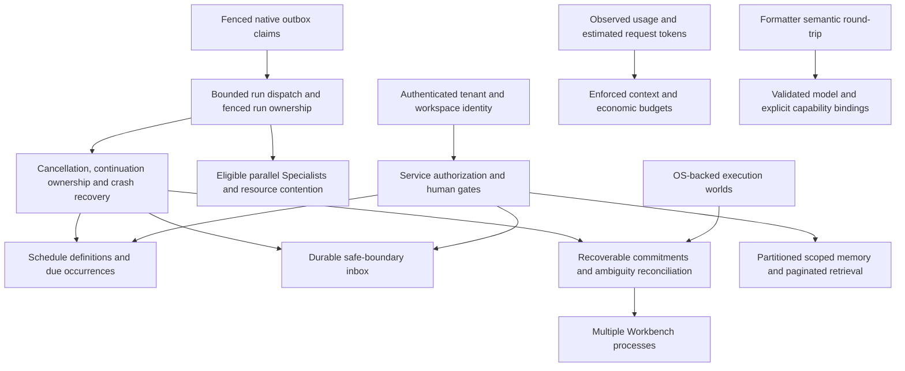

# Experts debt closure evidence

This tranche continues `feature/expert-teams` from `a892120`. A fresh baseline passed 1,064 tests. This mission remains incomplete: verified application slices and unpublished upstream improvements do not close distributed execution or production trust.

The architectural dependency graph is:

Schedule definitions are application policy. Actual runs remain Cognate outbox work. Inbox acceptance, wake-up, incorporation and acknowledgment are separate states. Delivery leases alone cannot fence a run's event writes or arbitrary external effects. Unknown physical outcomes require reconciliation.

## Inventory and architectural ownership

Statuses describe observed implementation, not promised work. Cost/risk is relative engineering scope, not a delivery estimate.

| Finding / source | Owner and controlling invariant | Required change / acceptance evidence | Cost / risk | Disposition |
|---|---|---|---|---|
| Autonomous scheduling; `src/workbench/automation.ts` only records intent | Workbench definitions; Cognate dispatch. Stable schedule/version/occurrence identity | Native evaluator and UI; actual PostgreSQL SIGKILL/restart, recurrence/DST, idempotency, failure, cancellation and approval tests; `docs/schedules.md` | Large / high | Partially closed — native Expert/Team schedules work in one process; legacy workflow intent is not automatically migrated; distributed ownership absent |
| Parallel Experts; runtime dispatcher serial | Cognate. Per-run order, authority and replay remain isolated | Upstream capacities 1/2/4/8, conflicting resources, cancellation, continuation and PostgreSQL pass; explicit trusted eligibility policy required | Medium / high | Partially closed — upstream contract tested; supported publication and Workbench integration pending |
| Live steering; `ExpertsService` next-assignment queue | Native recorded capability + Workbench routing. Only authorized safe-boundary incorporation | `team.inbox.*` records ordered, bounded, deduplicated receipts; active-run next-decision and SIGKILL replay tests pass; no inference interruption | Large / high | Partially closed — shared Team live inbox works; generalized SDK inbox and standalone live steering remain open |
| Memory aggregate and character budgets; `src/experts/state.ts`, `service.ts` | Workbench. Immutable identity/scope and event traceability | Hash-verified partitions, >5 MiB interrupted migration, erasure, paginated 205-item scoped reads, comparable and 8.49 MB PG benchmarks; actual budget invocation receipts | Large / high | Partially closed — bounded writes/responses and budgets work; global root CAS, materialized lexical retrieval and model-specific tokenization remain |
| Multiple processes; live-context effect dispatch | Cognate. One current authorized owner, stale writers fenced | PostgreSQL claims, renewal, fence checks, compatibility and fault injection; ambiguous effects blocked | Large / very high | Still open — not implemented |
| Production trust; dev bearer auth, command guards | Cognate execution + Workbench identity/authorization. Authentication is not containment | Durable identities/sessions and tenant isolation; OS escape/egress/cleanup tests and security review | Very large / very high | Still open — not implemented |
| Formatter difference; installed DomainForge 0.19.0 | DomainForge formatting. Equivalent semantics and comments | Original/formatted validate; normalized AST equality; all 37 original comments retained; idempotence and clean check; upstream 4 fidelity tests pass | Small / low | Closed — verified |
| Outbox stale settlement; upstream `events/dispatcher.ts`, store implementations | Cognate. Expired claimant cannot settle successor's work | Claim generation, conditional renew/settle; 73 memory/SQLite/event tests and 29 PostgreSQL conformance tests pass | Medium / high | Partially closed — verified upstream source; unpublished integration, caller-clock skew and run fencing remain |
| Substitution only records intent | Workbench provider binding. Frozen active routes | Rebind only future eligible calls without authority widening; provider integration evidence | Medium / high | Still open — not implemented |
| Parallelism plan has no workers | Workbench policy over Cognate concurrency | UI capacity maps to native dispatcher; conflict eligibility tested | Medium / high | Still open — prerequisite runtime concurrency |
| Budget information only; `economics.ts` | Workbench. Unknown price is not zero | Frozen Expert context/output/token/cost limits, failure reservations and observed receipts; five tests including real native runs and restart; browser usage inspection | Medium / high | Partially closed — Expert attempt limits enforced; ordinary coding-session/global spending ceilings remain open |
| Generic `subagent.start` fire-and-forget | Cognate generalized child completion, Workbench tool | Durable return available to ordinary parent without browser/manual next turn | Medium / high | Partially closed — native Expert Assignments return durably; generic tool still fire-and-forget |
| `routeExecutor` unused | Workbench. Selection cannot widen eligibility or reroute active assignments | Connect configured eligible executor routes to bounded task kind with observable selection | Medium / high | Still open — not implemented |
| Provider delays shutdown | Cognate cancellation/drain; provider abort behavior | Bounded close and crash-safe interrupted run recovery with slow/uncooperative provider | Medium / high | Still open — not implemented |
| Legacy tool recovery differs from Expert commitments | Cognate native effects + Workbench tool integration | Ordinary coding effect ambiguity/replay journeys equivalent to Expert path | Large / high | Still open — not implemented |
| Composer fabricated zeros reported in old ledger | Workbench. Show only measured data | Main composer uses real history counts; child row now shows unavailable usage; focused render regression passes | Small / low | Closed — verified (unknown usage remains explicitly unknown) |
| Trajectory/developer visibility | Workbench. Views are projections | Trace read view already exists; missing interactions must be inventoried separately | Small / low | Partially closed — trace read view works |
| Global Board and Evidence/Reviews navigation | Workbench. Reuse supported views | Reachable consolidated task/evidence navigation or concrete missing product decision | Medium / medium | Still open — not implemented |
| BACKLOG/BLOCKED controls | Workbench. State transitions require contract preconditions | Executable set/clear actions and failure explanations with durable journey tests | Small / medium | Partially closed — server transitions/renderer exist, workflow controls incomplete |
| Artifact preview fidelity | Workbench. Representation follows actual artifact type | Preview selected supported formats; unsupported reason; artifact access tests | Medium / medium | Still open — not implemented |
| Variant experimentation/worktrees | Workbench; Cognate execution-world isolation | Working variant lifecycle and truthful workspace isolation semantics | Large / high | Partially closed — cognitive directory fork is accidental-change protection only |
| Executor/economics settings | Workbench. Settings drive real selection/enforcement | Configure actual available executors and budgets, display observed accounting | Medium / medium | Still open — prerequisites routing and budget enforcement |
| Historical 21 NOT_IMPLEMENTED controls | Workbench. Disabled controls explain themselves visibly | Current source removed marker and implements T11 surfaces; re-audit remaining disabled affordances | Small / low | Partially closed — historical finding stale; final UI audit pending |
| Cognitive `case.*`, `criterion.*`, `world.*`, `verification.run`, `risk.assess`, `experiment.*`, `method.*`, `ui.*` unbound | Workbench IDM and adapter. Explicit semantic references are not policy execution | Validated concepts/observed journeys and 20 bindings; actual recorded `ui.context` SemanticRef and cognitive regressions pass | Medium / medium | Closed — verified |
| Directory copy described as isolation | Workbench docs; Cognate execution backend. Copy is not containment | Accurate boundaries and actual selected contained backend evidence | Large / high | Partially closed — known gap states limit; OS containment absent |
| RiskPreflight incomplete classification | Workbench. Unsupported/unclassified remains conservatively gated | Adversarial command family tests, explicit unsupported cases; never OS isolation claim | Medium / high | Still open — not implemented |
| Unproven cognitive abstractions not promoted | Cognate. Promotion requires independent cross-domain evidence | Preserve local-proof status; no speculative core contracts | None / low | Superseded — local proof remains intentionally application-scoped |
| Stale source references / SQLite claims | Workbench documentation | Removed source comment references to deleted APP/DEVIATIONS and SQLite runtime claims; PostgreSQL persistence documentation retained | Small / low | Partially closed — source repair implemented; historical migration provenance remains explicitly historical |
| Nonexistent remote-workspaces-live recipe | Workbench documentation | Current instructions name actual suite/recipes; do not invent a command | Small / low | Partially closed — current known-gaps explicitly rejects obsolete command |
| Migration cutover / main / absent provenance | Workbench repository history | Preserve historical distinctions and cite only artifacts actually present; no upstream reconstruction deletion | Small / medium | Still open — evidence reconciliation pending |

## Upstream and release evidence

Local Cognate base is `f68330e`; the original sibling has user modifications in its two status files and is preserved. Task work is isolated in `.tmp/donor/cognate-debt` on `feature/durable-dispatch-debt`.

Upstream commits `ab4dd2a` (fenced native dispatch, bounded run admission and transaction-local PostgreSQL replay), `920c4c9` (opt-in Linux execution world and gates), `06a520b` (stronger actual secret/network denial evidence) and `48ad057` (precise compatibility limits) are pushed. [Cognate PR #42](https://github.com/GodSpeedAI/Cognate/pull/42) is the review/release boundary. CI verification and clean-room packaging passed on `06a520b`; later documentation changes pass the narrow documentation gate. No new linked-version release is consumed by Workbench.

Read-only GitHub and npm checks on 2026-10-14 observed Cognate release `v0.3.0` at `f33cf18d9ee9d96310200658a888360d542a5cf3`, with runtime-bun, events and store-postgres 0.3.0 available. This does not establish that new contracts are published. Workbench remains pinned to 0.2.0 until supported integration passes. Linked-version upstream releases use Release Please and npm trusted publishing; local source/test success is not publication evidence.

Local DomainForge source `c4a2204` contains formatter fix `5feeb93` before tags 0.19.0–0.21.0. Installed CLI reports 0.19.0. Executable verification proves normalized AST equality, retention of all 37 comments in the original fixture, idempotence and zero violations. New modeled journeys also pass the same gate. No duplicate upstream formatter patch is warranted.

## Observed application and upstream slices

The native implementation files are `src/schedules/*`, `src/experts/persistence.ts`, `pagination.ts`, `economics.ts`, the existing `ExpertsService`, `agent.coding`, `expertsProjection`, `domain/index.ts`, and `src/ui/experts/*`. All canonical changes remain native events. Source-erased accepted partitions fail verification and invalidate the public projection after native projection catch-up. Internal preparation and metadata rows are hidden by the governed service.

The comparative workload used 100 Experts, 20 Teams, 500 memories and 2,000 messages (917,487 bytes). Four single-writer operations improved from 3.62/s, p50/p95 231/453 ms, about 3.68 MB persisted payload, to 4.07/s, 219/293 ms and 172,772 bytes. The 8.49 MB workload achieved 2.08/s, p50/p95 490/593 ms, 200,392 bytes for four writes and 906 ms restart/rebuild. These are small local WSL2/pg0 measurements, not universal guarantees. Root contention is still observable. Full hardware, concurrency, RSS, method and limitations are in `docs/experts-scale-baseline.md`.

Upstream native execution tests observe maxima 1/2/4/8 at the corresponding capacities, with approximately 331/166/86/45 ms for eight 40 ms steps. Resource conflicts serialize. The same gate covers recovered/resumed runs; all 96 focused runtime/service/continuation tests pass. All 81 upstream verification gates pass with required SXR and compatibility fixtures. This still does not fence run writes across processes. A new opt-in Linux namespace execution provider is undergoing separate adversarial verification; it is not an authenticated production deployment or a Workbench dependency.

Luna recon and implementation workers became unavailable because their service reported its usage limit. Their finished work was reviewed locally; unfinished tasks are not represented as completed.

Full integration initially exposed an actual SDK pool-starvation deadlock during six concurrent Team membership changes. PostgreSQL activity showed the lock owner waiting for an extra pooled connection while all other connections waited for its position-counter transaction lock. The upstream fix keeps duplicate receipt reads on the transaction executor; its saturated two-connection regression fails before the fix and passes three repetitions afterward. Workbench coalesces identical immutable preparation traffic per service/caller/content-address, without retaining private payloads or replacing native durability. The original membership journey then passes five repetitions (15 tests, 75 assertions, 12.20 seconds), with its assertions and 30-second bound unchanged.

## Verification log

- Fresh baseline: `just verify > /tmp/workbench-debt-baseline.log 2>&1` passed **1,064 tests, zero failures, 6,536 assertions, 85 files, 407.91 seconds**. Started before behavior edits; test discovery was fixed at invocation. Later canonical formatting changed the semantic source digest without changing its meaning. Final exact-tree verification will be separate.
- First Workbench slices: `just typecheck` passed; `bun test --timeout 15000 test/sea-format.test.ts test/ui-observability.test.tsx test/J-F-delegation.test.ts test/workbench-config-file.test.ts` passed **18 tests, zero failures, 48 assertions** (5.34 seconds), using authorized local fixtures. Earlier unprivileged fixture startup failed; it was sandbox denial, not a product regression.
- Repository starts clean at `a892120` on `feature/expert-teams`.
- Context indexing was rejected by automatic approval review for external repository-data egress. Local bounded inspection continues; no external index is required.
- Integrated focused gate: 41 tests, zero failures, 303 assertions across 11 files, 88.69 seconds. Ownership/race hardening: 18 tests, zero failures, 96 assertions. Real budget gate: five tests, zero failures, 21 assertions. Browser schedule/usage journey: one desktop/mobile test passed; observations and screenshots in `screenshots/experts-debt/`.
- Full Workbench regression after immutable preparation coalescing passed 1,099 tests. Final candidate `just verify` passed **1,100 tests, zero failures, 6,856 assertions across 96 files (629.97 seconds)**, including the live-inbox browser, evaluator health and conservative retry-accounting changes. [The complete report](experts-debt-verification.md) records scope, commits, failures, measurements and unfulfilled acceptance conditions.
