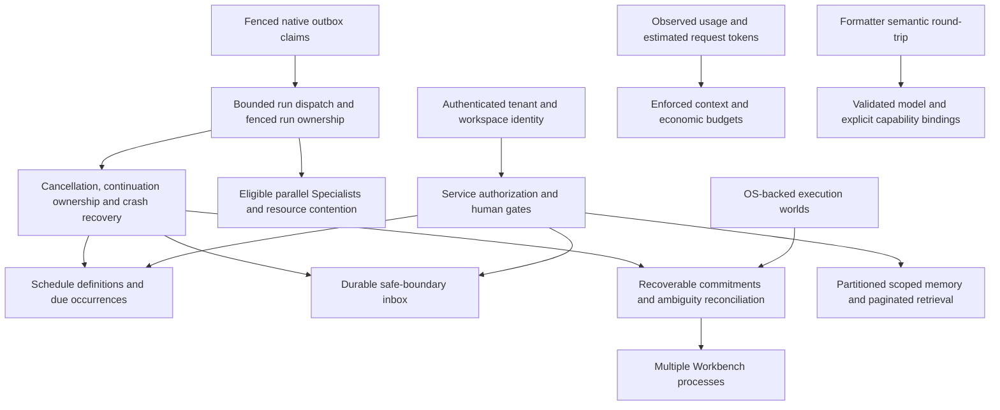

# Experts debt closure evidence

This tranche continues `feature/expert-teams` from `a892120`. The previous release's 1,064 passing tests are historical evidence; a fresh baseline is running. No mandatory debt is closed by the plan alone.

The architectural dependency graph is:

Schedule definitions are application policy. Actual runs remain Cognate outbox work. Inbox acceptance, wake-up, incorporation and acknowledgment are separate states. Delivery leases alone cannot fence a run's event writes or arbitrary external effects. Unknown physical outcomes require reconciliation.

## Inventory and architectural ownership

Statuses describe observed implementation, not promised work. Cost/risk is relative engineering scope, not a delivery estimate.

| Finding / source | Owner and controlling invariant | Required change / acceptance evidence | Cost / risk | Disposition |
|---|---|---|---|---|
| Autonomous scheduling; `src/workbench/automation.ts` only records intent | Workbench definitions; Cognate dispatch. Stable schedule/version/occurrence identity | Native runs after abrupt restart; bounded misfires, timezone/DST, cancellation and authorization; UI receipts | Large / high | Still open — not implemented |
| Parallel Experts; runtime dispatcher serial | Cognate. Per-run order, authority and replay remain isolated | Actual overlapping runs at capacities 1/2/4/8; conflicting work serialized | Medium / high | Still open — not implemented |
| Live steering; `ExpertsService` next-assignment queue | Cognate inbox + Workbench routing. Only authorized safe-boundary incorporation | Active-run redirect, acknowledgments, sequence/dedupe and restart proof | Large / high | Still open — not implemented |
| Memory aggregate and character budgets; `src/experts/state.ts`, `service.ts` | Workbench. Immutable identity/scope and event traceability | Measured ownership partitioning, indexed retrieval/pagination and reversible migration; token/budget enforcement | Large / high | Still open — not implemented |
| Multiple processes; live-context effect dispatch | Cognate. One current authorized owner, stale writers fenced | PostgreSQL claims, renewal, fence checks, compatibility and fault injection; ambiguous effects blocked | Large / very high | Still open — not implemented |
| Production trust; dev bearer auth, command guards | Cognate execution + Workbench identity/authorization. Authentication is not containment | Durable identities/sessions and tenant isolation; OS escape/egress/cleanup tests and security review | Very large / very high | Still open — not implemented |
| Formatter difference; installed DomainForge 0.19.0 | DomainForge formatting. Equivalent semantics and comments | Original/formatted validate; normalized AST equality; all 37 original comments retained; idempotence and clean check; upstream 4 fidelity tests pass | Small / low | Closed — verified |
| Outbox stale settlement; upstream `events/dispatcher.ts`, store implementations | Cognate. Expired claimant cannot settle successor's work | Claim generation, conditional renew/settle and stale-owner conformance across stores | Medium / high | Still open — upstream slice in progress |
| Substitution only records intent | Workbench provider binding. Frozen active routes | Rebind only future eligible calls without authority widening; provider integration evidence | Medium / high | Still open — not implemented |
| Parallelism plan has no workers | Workbench policy over Cognate concurrency | UI capacity maps to native dispatcher; conflict eligibility tested | Medium / high | Still open — prerequisite runtime concurrency |
| Budget information only; `economics.ts` | Workbench. Unknown price is not zero | Actual provider usage and reserved limits at invocation; failure/replay tests | Medium / high | Still open — not implemented |
| Generic `subagent.start` fire-and-forget | Cognate generalized child completion, Workbench tool | Durable return available to ordinary parent without browser/manual next turn | Medium / high | Partially closed — native Expert Assignments return durably; generic tool still fire-and-forget |
| `routeExecutor` unused | Workbench. Selection cannot widen eligibility or reroute active assignments | Connect configured eligible executor routes to bounded task kind with observable selection | Medium / high | Still open — not implemented |
| Provider delays shutdown | Cognate cancellation/drain; provider abort behavior | Bounded close and crash-safe interrupted run recovery with slow/uncooperative provider | Medium / high | Still open — not implemented |
| Legacy tool recovery differs from Expert commitments | Cognate native effects + Workbench tool integration | Ordinary coding effect ambiguity/replay journeys equivalent to Expert path | Large / high | Still open — not implemented |
| Composer fabricated zeros reported in old ledger | Workbench. Show only measured data | Main composer uses real history counts; child row now shows unavailable usage; focused render regression passes | Small / low | Closed — verified (unknown usage remains explicitly unknown) |
| Trajectory/developer visibility | Workbench. Views are projections | Trace read view already exists; missing interactions must be inventoried separately | Small / low | Partially closed — trace read view works |
| Global Board and Evidence/Reviews navigation | Workbench. Reuse supported views | Reachable consolidated task/evidence navigation or concrete missing product decision | Medium / medium | Still open — not implemented |
| BACKLOG/BLOCKED controls | Workbench. State transitions require contract preconditions | Executable set/clear actions and failure explanations with durable journey tests | Small / medium | Partially closed — server transitions/renderer exist, workflow controls incomplete |
| Artifact preview fidelity | Workbench. Representation follows actual artifact type | Preview selected supported formats; unsupported reason; artifact access tests | Medium / medium | Still open — not implemented |
| Variant experimentation/worktrees | Workbench; Cognate execution-world isolation | Working variant lifecycle and truthful workspace isolation semantics | Large / high | Partially closed — cognitive directory fork is accidental-change protection only |
| Executor/economics settings | Workbench. Settings drive real selection/enforcement | Configure actual available executors and budgets, display observed accounting | Medium / medium | Still open — prerequisites routing and budget enforcement |
| Historical 21 NOT_IMPLEMENTED controls | Workbench. Disabled controls explain themselves visibly | Current source removed marker and implements T11 surfaces; re-audit remaining disabled affordances | Small / low | Partially closed — historical finding stale; final UI audit pending |
| Cognitive `case.*`, `criterion.*`, `world.*`, `verification.run`, `risk.assess`, `experiment.*`, `method.*`, `ui.*` unbound | Workbench IDM and adapter. Explicit semantic references are not policy execution | Model actual cognitive journeys then bind 20 contracts; preserve human-only gates | Medium / medium | Still open — not implemented |
| Directory copy described as isolation | Workbench docs; Cognate execution backend. Copy is not containment | Accurate boundaries and actual selected contained backend evidence | Large / high | Partially closed — known gap states limit; OS containment absent |
| RiskPreflight incomplete classification | Workbench. Unsupported/unclassified remains conservatively gated | Adversarial command family tests, explicit unsupported cases; never OS isolation claim | Medium / high | Still open — not implemented |
| Unproven cognitive abstractions not promoted | Cognate. Promotion requires independent cross-domain evidence | Preserve local-proof status; no speculative core contracts | None / low | Superseded — local proof remains intentionally application-scoped |
| Stale source references / SQLite claims | Workbench documentation | Repair source paths and persistence descriptions against actual tree | Small / low | Still open — repair slice in progress |
| Nonexistent remote-workspaces-live recipe | Workbench documentation | Current instructions name actual suite/recipes; do not invent a command | Small / low | Partially closed — current known-gaps explicitly rejects obsolete command |
| Migration cutover / main / absent provenance | Workbench repository history | Preserve historical distinctions and cite only artifacts actually present; no upstream reconstruction deletion | Small / medium | Still open — evidence reconciliation pending |

## Upstream and release evidence

Local Cognate base is `f68330e`; the original sibling has user modifications in its two status files and is preserved. Task work is isolated in `.tmp/donor/cognate-debt` on `feature/durable-dispatch-debt`.

Read-only GitHub and npm checks on 2026-10-14 observed Cognate release `v0.3.0` at `f33cf18d9ee9d96310200658a888360d542a5cf3`, with runtime-bun, events and store-postgres 0.3.0 available. This does not establish that new contracts are published. Workbench remains pinned to 0.2.0 until supported integration passes. Linked-version upstream releases use Release Please and npm trusted publishing; local source/test success is not publication evidence.

Local DomainForge source `c4a2204` contains formatter fix `5feeb93` before tags 0.19.0–0.21.0. Installed CLI reports 0.19.0. Recon observed identical normalized AST, all 37 comment lines and idempotent formatted output for the current Workbench model; independent executable verification is in progress. No duplicate upstream formatter patch is warranted.

## Verification log

- Fresh baseline: `just verify > /tmp/workbench-debt-baseline.log 2>&1` passed **1,064 tests, zero failures, 6,536 assertions, 85 files, 407.91 seconds**. Started before behavior edits; test discovery was fixed at invocation. Later canonical formatting changed the semantic source digest without changing its meaning. Final exact-tree verification will be separate.
- First Workbench slices: `just typecheck` passed; `bun test --timeout 15000 test/sea-format.test.ts test/ui-observability.test.tsx test/J-F-delegation.test.ts test/workbench-config-file.test.ts` passed **18 tests, zero failures, 48 assertions** (5.34 seconds), using authorized local fixtures. Earlier unprivileged fixture startup failed; it was sandbox denial, not a product regression.
- Repository starts clean at `a892120` on `feature/expert-teams`.
- Context indexing was rejected by automatic approval review for external repository-data egress. Local bounded inspection continues; no external index is required.
