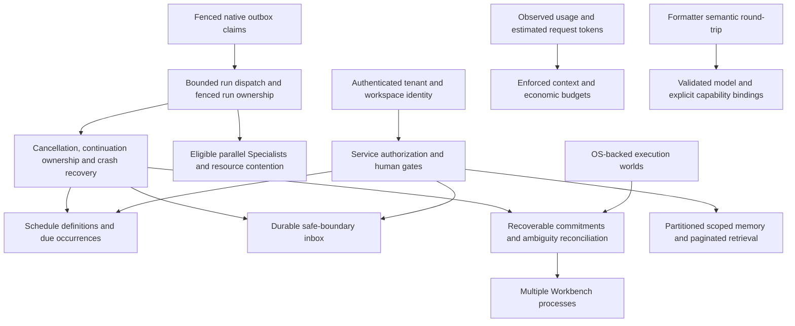

# Experts debt closure evidence

This tranche continues `feature/expert-teams` from `a892120`. A fresh baseline passed 1,064 tests. The published SDK 0.4.0 integration and capacity characterization pass 1,104 tests in the latest recorded full verification. This mission remains incomplete: verified application/native SDK slices do not close distributed execution or production trust.

The architectural dependency graph is:

Schedule definitions are application policy. Actual runs remain Cognate outbox work. Inbox acceptance, wake-up, incorporation and acknowledgment are separate states. Delivery leases alone cannot fence a run's event writes or arbitrary external effects. Unknown physical outcomes require reconciliation.

## Inventory and architectural ownership

Statuses describe observed implementation, not promised work. Cost/risk is relative engineering scope, not a delivery estimate.

| Finding / source | Owner and controlling invariant | Required change / acceptance evidence | Cost / risk | Disposition |
|---|---|---|---|---|
| Autonomous scheduling; `src/workbench/automation.ts` only records intent | Workbench definitions; Cognate dispatch. Stable schedule/version/occurrence identity | Native evaluator and UI; actual PostgreSQL SIGKILL/restart, recurrence/DST, idempotency, failure, cancellation and approval tests; `docs/schedules.md` | Large / high | Partially closed — native Expert/Team schedules work in one process; legacy workflow intent is not automatically migrated; distributed ownership absent |
| Parallel Experts; runtime dispatcher serial | Cognate. Per-run order, authority and replay remain isolated | SDK 0.4.0 published/consumed; capacities 1/2/4/8, exclusion, cancellation, continuation, PG and consumer overlap pass | Medium / high | Partially closed — conflict-aware per-resource workspace/world/configuration keys now derive from authoritative state with overlap, alias-collision, forged-identity and restart journeys; Team admission/batching policy now resolves from authoritative Team metadata (lanes + batch) with capacity-free-wait and client-policy-refusal journeys |
| Live steering; `ExpertsService` next-assignment queue | Native recorded capability + Workbench routing. Only authorized safe-boundary incorporation | `team.inbox.*` records ordered, bounded, deduplicated receipts; active-run next-decision and SIGKILL replay tests pass; no inference interruption | Large / high | Partially closed — shared Team live inbox works; generalized SDK inbox and standalone live steering remain open |
| Memory aggregate and character budgets; `src/experts/state.ts`, `service.ts` | Workbench. Immutable identity/scope and event traceability | Hash-verified partitions, >5 MiB interrupted migration, erasure, paginated 205-item scoped reads, comparable and 8.49 MB PG benchmarks; actual budget invocation receipts | Large / high | Partially closed — bounded writes/responses and budgets work; global root CAS, materialized lexical retrieval and model-specific tokenization remain |
| Multiple processes; live-context effect dispatch | Cognate. One current authorized owner, stale writers fenced | PostgreSQL claims, renewal, fence checks, compatibility and fault injection; ambiguous effects blocked | Large / very high | Still open — not implemented |
| Production trust; dev bearer auth, command guards | Cognate execution + Workbench identity/authorization. Authentication is not containment | Durable identities/sessions and tenant isolation; OS escape/egress/cleanup tests and security review | Very large / very high | Partially closed — durable revocable sessions are the default posture with a system-guarded identity ledger, operator-only user grants, observed tenant isolation on one shared store, aggregate contained-execution containment across processes with kernel CPU/address-space caps, hardened headers/CSP, and an independent adversarial security review with all MUST-fix findings remediated; multi-tenant application seeding, live aggregate memory accounting and a production certification claim remain open |
| Formatter difference; installed DomainForge 0.19.0 | DomainForge formatting. Equivalent semantics and comments | Original/formatted validate; normalized AST equality; all 37 original comments retained; idempotence and clean check; upstream 4 fidelity tests pass | Small / low | Closed — verified |
| Outbox stale settlement; upstream `events/dispatcher.ts`, store implementations | Cognate. Expired claimant cannot settle successor's work | Claim generation, conditional renew/settle; store conformance passes and published 0.4.0 is consumed | Medium / high | Partially closed — stale outbox settlement refused; caller-clock skew and run-write fencing remain |
| Substitution only records intent | Workbench provider binding. Frozen active routes | Rebind only future eligible calls without authority widening; provider integration evidence | Medium / high | Still open — not implemented |
| Parallelism plan has no workers | Workbench policy over Cognate concurrency | UI capacity maps to native dispatcher; conflict eligibility tested | Medium / high | Still open — prerequisite runtime concurrency |
| Budget information only; `economics.ts` | Workbench. Unknown price is not zero | Frozen Expert context/output/token/cost limits, failure reservations and observed receipts; five tests including real native runs and restart; browser usage inspection | Medium / high | Partially closed — Expert attempt limits enforced; ordinary coding-session/global spending ceilings remain open |
| Generic `subagent.start` fire-and-forget | Cognate generalized child completion, Workbench tool | Durable return available to ordinary parent without browser/manual next turn | Medium / high | Partially closed — native Expert Assignments return durably; generic tool still fire-and-forget |
| `routeExecutor` unused | Workbench. Selection cannot widen eligibility or reroute active assignments | Connect configured eligible executor routes to bounded task kind with observable selection | Medium / high | Still open — not implemented |
| Provider delays shutdown | Cognate cancellation/drain; provider abort behavior | Bounded close and crash-safe interrupted run recovery with slow/uncooperative provider | Medium / high | Still open — not implemented |
| Legacy tool recovery differs from Expert commitments | Cognate native effects + Workbench tool integration | Ordinary coding effect ambiguity/replay journeys equivalent to Expert path | Large / high | Still open — not implemented |
| Composer fabricated zeros reported in old ledger | Workbench. Show only measured data | Main composer uses real history counts; child row now shows unavailable usage; focused render regression passes | Small / low | Closed — verified (unknown usage remains explicitly unknown) |
| Trajectory/developer visibility | Workbench. Views are projections | Trace read view already exists; missing interactions must be inventoried separately | Small / low | Partially closed — trace read view works |
| Global Board and Evidence/Reviews navigation | Workbench. Reuse supported views | Reachable consolidated task/evidence navigation or concrete missing product decision | Medium / medium | Still open — not implemented |
| BACKLOG/BLOCKED controls | Workbench. State transitions require contract preconditions | Executable set/clear actions and failure explanations with durable journey tests | Small / medium | Partially closed — server transitions/renderer exist, workflow controls incomplete |
| Artifact preview fidelity | Workbench. Representation follows actual artifact type | Preview selected supported formats; unsupported reason; artifact access tests | Medium / medium | Still open — not implemented |
| Variant experimentation/worktrees | Workbench; Cognate execution-world isolation | Working variant lifecycle and truthful workspace isolation semantics | Large / high | Partially closed — cognitive directory fork is accidental-change protection only |
| Executor/economics settings | Workbench. Settings drive real selection/enforcement | Configure actual available executors and budgets, display observed accounting | Medium / medium | Still open — prerequisites routing and budget enforcement |
| Historical 21 NOT_IMPLEMENTED controls | Workbench. Disabled controls explain themselves visibly | Current source removed marker and implements T11 surfaces; re-audit remaining disabled affordances | Small / low | Partially closed — historical finding stale; final UI audit pending |
| Cognitive `case.*`, `criterion.*`, `world.*`, `verification.run`, `risk.assess`, `experiment.*`, `method.*`, `ui.*` unbound | Workbench IDM and adapter. Explicit semantic references are not policy execution | Validated concepts/observed journeys and 20 bindings; actual recorded `ui.context` SemanticRef and cognitive regressions pass | Medium / medium | Closed — verified |
| Directory copy described as isolation | Workbench docs; Cognate execution backend. Copy is not containment | Accurate boundaries and actual selected contained backend evidence | Large / high | Partially closed — known gap states limit; OS containment absent |
| RiskPreflight incomplete classification | Workbench. Unsupported/unclassified remains conservatively gated | Adversarial command family tests, explicit unsupported cases; never OS isolation claim | Medium / high | Still open — not implemented |
| Unproven cognitive abstractions not promoted | Cognate. Promotion requires independent cross-domain evidence | Preserve local-proof status; no speculative core contracts | None / low | Superseded — local proof remains intentionally application-scoped |
| Stale source references / SQLite claims | Workbench documentation | Removed source comment references to deleted APP/DEVIATIONS and SQLite runtime claims; PostgreSQL persistence documentation retained | Small / low | Partially closed — source repair implemented; historical migration provenance remains explicitly historical |
| Nonexistent remote-workspaces-live recipe | Workbench documentation | Current instructions name actual suite/recipes; do not invent a command | Small / low | Partially closed — current known-gaps explicitly rejects obsolete command |
| Migration cutover / main / absent provenance | Workbench repository history | Current standalone verification passes on published dependencies; legacy missing artifacts remain distinct from native evidence; original reconstruction retained | Small / medium | Partially closed — current validation reconciled; migration cleanup and feature merge are separate, missing legacy provenance remains missing |

## Upstream and release evidence

Local Cognate base is `f68330e`; the original sibling has user modifications in its two status files and is preserved. Task work used `.tmp/donor/cognate-debt` on `feature/durable-dispatch-debt`; this temporary source is not a Workbench dependency.

Upstream commits `ab4dd2a` (fenced native dispatch, bounded run admission and transaction-local PostgreSQL replay), `920c4c9` (opt-in Linux execution world and gates), `06a520b` (stronger actual secret/network denial evidence) and `48ad057` (precise compatibility limits) formed the earlier PR #42 work. That release boundary is historical; Cognate 0.4.0 is now published and consumed by Workbench. See [SDK 0.4.0 release evidence](sdk-0.4.0-release.md) for the exact merge, publication matrix and consumer proof.

Historical registry checks on 2026-10-14 observed Cognate v0.3.0 before the linked release completed. That snapshot is superseded: the 0.4.0 workflow published all 45 linked packages, the Workbench pins 23 direct and 35 resolved SDK packages to 0.4.0, and the clean-room consumer verified the release. The linked-release evidence records publication separately from local source and test results.

Local DomainForge source `c4a2204` contains formatter fix `5feeb93` before tags 0.19.0–0.21.0. Installed CLI reports 0.19.0. Executable verification proves normalized AST equality, retention of all 37 comments in the original fixture, idempotence and zero violations. New modeled journeys also pass the same gate. No duplicate upstream formatter patch is warranted.

## Observed application and upstream slices

The native implementation files are `src/schedules/*`, `src/experts/persistence.ts`, `pagination.ts`, `economics.ts`, the existing `ExpertsService`, `agent.coding`, `expertsProjection`, `domain/index.ts`, and `src/ui/experts/*`. All canonical changes remain native events. Source-erased accepted partitions fail verification and invalidate the public projection after native projection catch-up. Internal preparation and metadata rows are hidden by the governed service.

Economic ceilings are logical preflight guards, not a physical billing guarantee. Committed native
invocation outcomes replay without another logical call, but a crash after dispatch and before its
outcome can leave unknown provider charges. Durable pre-dispatch reservation/reconciliation remains
an explicit A4 limitation alongside indexed retrieval and global budgets.

The comparative workload used 100 Experts, 20 Teams, 500 memories and 2,000 messages (917,487 bytes). Four single-writer operations improved from 3.62/s, p50/p95 231/453 ms, about 3.68 MB persisted payload, to 4.07/s, 219/293 ms and 172,772 bytes. The 8.49 MB workload achieved 2.08/s, p50/p95 490/593 ms, 200,392 bytes for four writes and 906 ms restart/rebuild. These are small local WSL2/pg0 measurements, not universal guarantees. Root contention is still observable. Full hardware, concurrency, RSS, method and limitations are in `docs/experts-scale-baseline.md`.

Upstream native execution tests observe maxima 1/2/4/8 at the corresponding capacities, with approximately 331/166/86/45 ms for eight 40 ms steps. Resource conflicts serialize. The same gate covers recovered/resumed runs; all 96 focused runtime/service/continuation tests pass. All 81 upstream verification gates pass with required SXR and compatibility fixtures. This still does not fence run writes across processes. A new opt-in Linux namespace execution provider is undergoing separate adversarial verification; it is not an authenticated production deployment or a Workbench dependency.

The pre-release audit snapshot below predates publication of Cognate 0.4.0. Its 0.3.0 registry observation and pending merge/publication gates are historical; current package publication and consumer evidence are recorded in [the release report](sdk-0.4.0-release.md). Remaining security and application gaps stay open as listed in the disposition matrix.

Full integration initially exposed an actual SDK pool-starvation deadlock during six concurrent Team membership changes. PostgreSQL activity showed the lock owner waiting for an extra pooled connection while all other connections waited for its position-counter transaction lock. The upstream fix keeps duplicate receipt reads on the transaction executor; its saturated two-connection regression fails before the fix and passes three repetitions afterward. Workbench coalesces identical immutable preparation traffic per service/caller/content-address, without retaining private payloads or replacing native durability. The original membership journey then passes five repetitions (15 tests, 75 assertions, 12.20 seconds), with its assertions and 30-second bound unchanged.

## Verification log

- T2 Team admission/batching policy: `test/J-TEAM-admission.test.ts` passes **2 tests** against
  actual PostgreSQL at capacity four — a Team limited to one concurrent run serializes its second
  disjoint-workspace run while three host slots stay free (the policy, not the process, decides),
  raising the authoritative limit to two lets the same pair overlap; a batch-one policy keeps the
  second queued root undispatched until the first finishes; client-supplied policy fields
  (`maxConcurrentRuns`, `admissionBatch`, `policy`) are refused on `expert.converse`/`team.converse`.
  `test/E2E-team-admission.test.ts` passes **1 test** in real Chromium: the Team editor exposes both
  policy fields with the effective-policy text and serialized reason, and a saved policy change
  lands only in authoritative Team metadata (screenshot
  `screenshots/concurrency/team-admission-policy.png`). Unit coverage: `test/expert-admission.test.ts`
  11 tests including Team-lane derivation, fail-closed invalid policy and lane/workspace key
  composition.
- T1 conflict-aware workspace-effect admission: `test/J-EXPERT-workspace-admission.test.ts` passes
  **4 tests** against actual PostgreSQL — two tool-bearing Experts on different workspaces overlap at
  capacity two with disjoint authoritative keys; aliased spellings of one workspace canonicalize to
  one record and serialize; a forged workspace identity is denied its effects (no provider call) and
  fails closed to the global exclusion key; per-resource keys and both overlap/serialization survive
  a full restart. `test/E2E-expert-workspace-admission.test.ts` passes **1 test** in real Chromium
  with two visible tool-bearing Expert results bound to two different workspaces at capacity two
  (screenshot `screenshots/concurrency/workspace-admission-desktop.png`). Unit coverage:
  `test/expert-admission.test.ts` 10 tests over authoritative-identity key derivation, configuration
  record keys, world-mutator enumeration and fail-closed cases.
- Fresh baseline: `just verify > /tmp/workbench-debt-baseline.log 2>&1` passed **1,064 tests, zero failures, 6,536 assertions, 85 files, 407.91 seconds**. Started before behavior edits; test discovery was fixed at invocation. Later canonical formatting changed the semantic source digest without changing its meaning. Final exact-tree verification will be separate.
- First Workbench slices: `just typecheck` passed; `bun test --timeout 15000 test/sea-format.test.ts test/ui-observability.test.tsx test/J-F-delegation.test.ts test/workbench-config-file.test.ts` passed **18 tests, zero failures, 48 assertions** (5.34 seconds), using authorized local fixtures. Earlier unprivileged fixture startup failed; it was sandbox denial, not a product regression.
- Repository starts clean at `a892120` on `feature/expert-teams`.
- Context indexing was rejected by automatic approval review for external repository-data egress. Local bounded inspection continues; no external index is required.
- Integrated focused gate: 41 tests, zero failures, 303 assertions across 11 files, 88.69 seconds. Ownership/race hardening: 18 tests, zero failures, 96 assertions. Real budget gate: five tests, zero failures, 21 assertions. Browser schedule/usage journey: one desktop/mobile test passed; observations and screenshots in `screenshots/experts-debt/`.
- A prior integrated candidate after immutable preparation coalescing passed 1,100 tests, zero failures, and 6,856 assertions across 96 files (629.97 seconds). The later published-SDK migration and capacity characterization passed `just verify` with **1,104 tests, zero failures, and 6,884 assertions across 96 files (408.21 seconds)**. [The complete report](experts-debt-verification.md) records scope, commits, failures, measurements and unfulfilled acceptance conditions.

## Verification log (T6/T7, 2026-10-17)

- T6 upstream run-write ownership: PR #48 (store fencing + executor ownership lifecycle +
  ambiguous-effect reconciliation) and PR #55 (held-lease recovery re-arm) merged into the
  Cognate main with green exact-head CI; the linked SDK releases **0.6.0** (recovered
  publication with the receipts gate and an independent 45/45 registry audit) and **0.6.1**
  (normal train, 45/45 publish + receipts in one run) are published. Full provenance:
  [sdk-0.6.0-release.md](sdk-0.6.0-release.md). A fresh clean-room consumer exercised the fenced
  ownership API and a runtime boot against the published packages.
- T7 Workbench multi-process integration: the Workbench pins all SDK dependencies to **0.6.1**
  (23 direct, 36 resolved) and exposes multi-process operation behind the verified
  `runOwnership: "multi-process"` configuration (`ambiguousSteps: "wait"`); the default
  single-process mode keeps historical restart semantics. `test/J-EXPERT-OWNERSHIP-MULTI.test.ts`
  passes the two-process crash/stale-writer journey against actual PostgreSQL: the killed
  process's in-flight effect is marked ambiguous and never re-performed (provider calls stay at
  one; no model invocation is ever recorded), the interrupted attempt stays booked in the billing
  ledger, the zombie writer's superseded-credential append is fenced with nothing appended, and
  the assignment settles only from the operator's explicit reconciliation. The SIGKILL
  (`J-EXPERT-INBOX-RECOVER`) and restart (`J-TEAM-RECOVER`) journeys that regressed against
  published 0.6.0 — see [sdk-0.6.0-release.md](sdk-0.6.0-release.md) — pass unchanged against
  0.6.1. Full gate: `just verify` passed **1,173 tests / 1,167 pass / 6 skip / 0 fail** across
  113 files.
