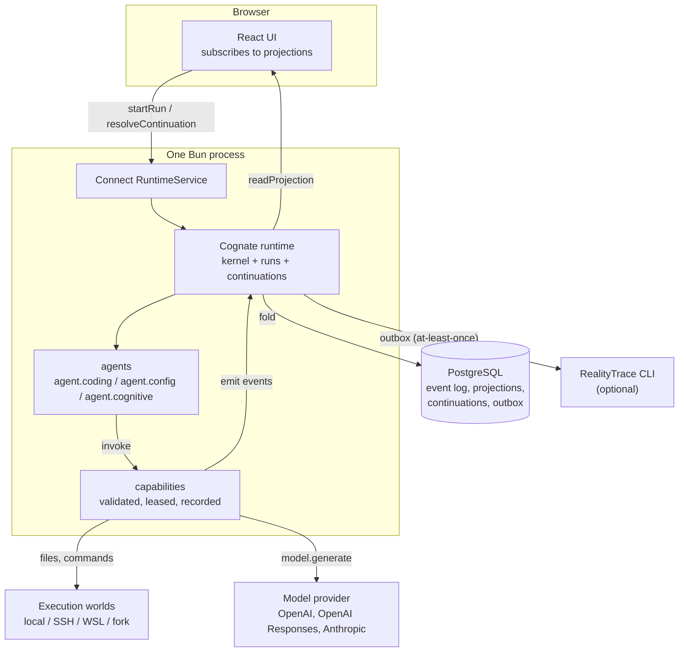

# Mental model

Cognate Workbench is a harness for developing agents that are governed and verifiable. Before
anything else: it is not a chat surface with some configuration panels attached. The domain model,
the capability bindings, the authority plane, the evidence ledger and the test suite are the point;
the transcript is one consumer of them.

This page describes the system's shape without implementation detail.
[Architecture](architecture.md) is where to go when you need to change something.

## The shape of it

Cognate Workbench is three ideas stacked on each other, and nearly every design decision follows
from keeping them separate.

**A durable record.** Everything that happens is appended to an event log in PostgreSQL. Nothing
mutates in place. Every screen in the app is a projection folded from that log.

**Governed capabilities.** Nothing consequential happens without going through a capability — a
named, leased unit of effect that validates its input, checks authority, performs the effect, and
records what it did. A model asking to do something is a request against a capability, not an
action.

**A derivation layer.** Task contracts, evidence ledgers, workflow graphs, world identity, and
affordances are all computed from the record. They are not stored, so they cannot drift from what
actually happened.

## The system in one picture

What to notice:

- There is no arrow from the UI to the database, and none from the UI to a capability. The browser
  asks the runtime to start a run or to resolve a continuation; it never writes.
- The model provider sits outside the trust boundary. The app calls it; it never accepts writes.
- RealityTrace is optional and off the critical path. Its arrow is the outbox, and a missing target
  degrades to "queued", never to an error.

## The record is the truth

The consequence that surprises newcomers: **nothing in this application holds mutable state.**

Not the session list. Not the plan. Not the task board. Not whether an approval is pending. Each of
those is a fold over events. Two consequences follow.

First, a restart is not a recovery mechanism, because there is nothing to recover: the log is
already the truth, and the projections are rebuilt from it. A pending approval is not an open
promise in somebody's memory; it is a durable continuation.

Second, a feature that reads and writes is almost always three pieces: a capability that validates,
an event, and a projection that folds. If you find yourself adding a fourth, be suspicious.

## Capabilities are the choke point

Every effect has a name and goes through a gate. `tool.edit` will not write outside the workspace.
`tool.bash` will not run a command the shell classifier flags as destructive without a human
saying yes. `task.review.decide` will refuse a caller that is not a `user` actor, which means an
agent cannot accept its own work.

This is why the vocabulary is worth internalising. "The agent wants to run `rm -rf`" is a *request*
against a capability. Whether it happens is a separate question with a separate answer, and the
answer is recorded.

## What the agent sees

The agent's world is deliberately narrow:

- `session.history` — the conversation so far.
- `workspace.path` — where to work.
- Seven tools, scoped by an agent preset for the turn.
- A step budget of 20.

It does not see the event log, the projections, the authority scopes as a policy object, or the
workbench. Authority reaches it as *refusals*, not as instructions. That is a design choice worth
reading about in [Why approval is a continuation](explanation/why-approval-is-a-continuation.md).

## Three layers of "done"

The system refuses to collapse completion. [Done levels](reference/domain-types.md) separate:

- **finished** — the step ran.
- **produced** — there is an artifact.
- **tested** — checks passed.
- **ready-for-review** — the contract says it is worth a look.
- **accepted** — a human decided.
- **operationalized** — it compounds into something reusable.

An agent narrating "I fixed it" moves the first two at most.

## Data flow, end to end

1. The operator picks a workspace, which is a directory on some execution world.
2. The operator sends a message. The UI starts an `agent.coding` run.
3. `agent.coding` reads history, calls the model, and loops over the tool calls the model returns.
4. Each tool call becomes a capability invocation. Authority is checked. If a gate says no, the
   model gets the refusal as a tool result and keeps going.
5. Results go back to the model as `role: "tool"` messages until it answers in plain text.
6. Every step is emitted as an event. Projections fold. The UI updates.
7. In the workbench, the same loop is bounded by a task contract: acceptance criteria, authority
   scopes, invariants, and an evidence ledger that review reads.

## Where the interesting complexity lives

Not in the tool loop. In three places:

- **The cognitive layer** ([subsystem](subsystems/cognitive-domain.md)) — world identity, lineage,
  frozen criteria, mediation, and the closed Surface grammar. It is a local proof of a framework
  idea, explicitly marked as such.
- **The workbench domain** ([subsystem](subsystems/workbench-domain.md)) — sixteen pure modules
  holding contracts, authority, ledgers, workflows, skills, automation, economics, and parallelism.
  All pure, all unit-tested, all with no I/O.
- **The write path** — every durable change starts a run. This is unusual and it has real
  consequences; see [Why `agent.config` is the write path](explanation/why-agent-config-is-the-write-path.md).

## Boundaries to keep in mind

| Boundary | What is on each side |
|---|---|
| Browser ↔ process | Connect RPC only; the UI has no direct data access |
| Process ↔ model provider | Outbound HTTPS; no inbound trust |
| Process ↔ execution world | `filesystem.*` and `process.exec`; path containment and a shell classifier, not a sandbox |
| Operator ↔ system | Two principals in one tenant; human-only decisions require the `user` actor |
| App ↔ RealityTrace | One-way outbox; the app never reads back for truth |

## Next

- [Architecture](architecture.md) — the views you need before modifying anything.
- [Subsystems](subsystems/) — one page per part, with what it deliberately does not own.
- [Send a turn](workflows/send-a-turn.md) — the main loop, in detail.
- [Glossary](glossary.md) — if a word stopped you, it is probably defined there.