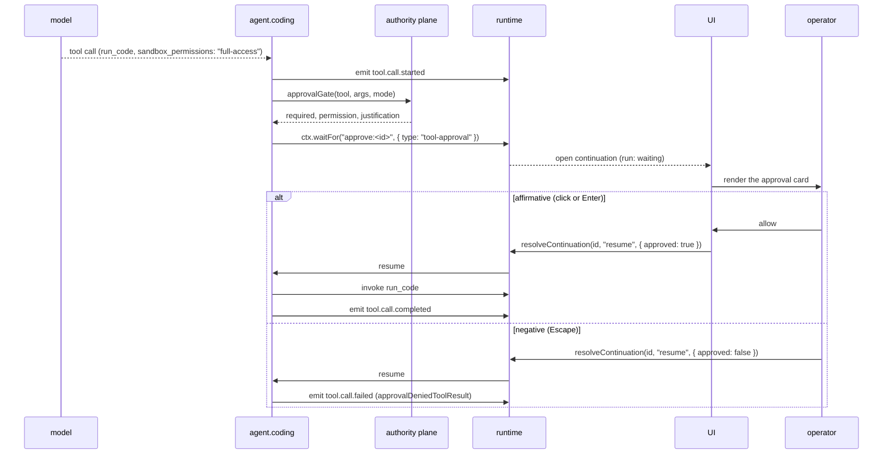

# Workflow: approval escalation

How a privileged operation is stopped, shown, decided, and recorded.

## Summary

A model asks for something outside what it currently holds. Four gates can catch it. If any says
"approval", the run opens a durable continuation and waits. The UI renders it as an approval card.
The operator decides with a click, `Enter` or `Escape`. The run resumes; denial feeds a fixed
refusal string back to the model and the loop continues.

## The four gates

| # | Gate | Catches | Where |
|---|---|---|---|
| 1 | Agent preset | A tool not in this turn's catalog | `agentCoding.ts` |
| 2 | Authority plane | A protected path, or a write outside the task's scopes | `workbench/authority.ts` |
| 3 | `approvalGate` | `run_code` requesting a sandbox permission above the session mode | `src/domain/approvalGate.ts` |
| 4 | `risk.assess` | A destructive shell operation | `cognitive/sentinel.ts` + `preflight.ts` |

Gate 2 is invoked only for `edit` and `bash`. Gate 3 only for `run_code`. Gate 4 only for `bash`, and
only when nothing else has already gated it.

Gate 2's `approval` verdict **upgrades** a decision that gates 3 and 4 would not have made, with
`permission: "workspace-write"` for `edit`, `"shell"` for `bash`, and the justification "the task
contract requires approval for this operation".

## Sequence

1. The model returns a tool call.
2. `tool.call.started` is emitted — **before** any gating, so the transcript has an entry to hang the
   approval on.
3. The four gates run in order.
4. If any requires approval, the agent emits the pending state and calls:

   ```ts
   ctx.waitFor(`approve:${toolCallId}`, {
     type: "tool-approval",
     condition: { kind: "human_approval" },
     payload: { tool, args, permission, justification },
   });
   ```

   The run's status becomes `waiting`. Nothing is held in memory.
5. The UI's `useContinuations()` surfaces it and renders an approval card showing the tool, its
   arguments, the requested permission, and the justification.
6. The operator acts: `Enter` or the affirmative button, `Escape` or the negative one. The UI calls
   `client.resolveContinuation(continuationId, "resume", { approved })`.
7. Approved → the tool runs, and `tool.call.completed` (or `failed`) is emitted.
   Denied → `tool.call.failed` with `approvalDeniedToolResult`, appended to the message list as a
   `role: "tool"` message, and the loop continues.
8. The decision is durable. Reloading the page shows the same card. Restarting the process shows the
   same card.

## The escalation predicate

```ts
approvalGate({ tool, args, mode })
```

requires approval exactly when `tool === "run_code"` and `args.sandbox_permissions` ranks above
`mode`.

```
read-only (0)  <  workspace-write (1)  <  full-access (2)
```

An unrecognised permission *or* mode ranks above every known one — fail-closed. `mode` is
normalised for case and spacing; when absent it defaults to `read-only`, the conservative choice.

The composer's access-mode dropdown feeds this: its value reaches `agent.coding` as
`AgentCodingInput.mode`. The resolution order for a send is the per-session override, then the pending
hero-composer choice when the session is being created, then the `permission` setting.

## What the operator sees

The approval card is one of the app's *consequential* surface registers — a stronger border, a
deliberate lift, an accent-coloured dot and label in the header. It is the one place a shadow is used
on purpose, because the product's own principle says approval gates must read as consequential.

The keyboard contract is one rule applied consistently: `Enter` = affirmative, `Escape` = negative.

## State changes

| Where | What |
|---|---|
| Runtime | the run moves to `waiting` with an open `tool-approval` continuation |
| Event log | `tool.call.started`; after the decision, `tool.call.completed` or `tool.call.failed` |
| Projections | the `sessions` and `session-trace` views pick both up |
| Outbox | an observation intent for `tool.call.*` if observed |

## Failure branches

| Branch | Behaviour |
|---|---|
| Denied | `approvalDeniedToolResult` as a tool result; the agent may try something else |
| The operator never decides | The run stays `waiting` indefinitely. That is intended |
| The process restarts while pending | The run is still `waiting` and the card is still there |
| A destructive `bash` needs authority | `risk.assess` composes a `preflight` Surface (target, impact, recovery, authority) that rides the same continuation |
| A protected path is hit | Not an approval: a hard deny, with `workbench.protection.blocked` recorded |

## Sequence diagram



## Source trail

- `src/domain/approvalGate.ts` — `approvalGate`, `ApprovalDecisionRequest`, `ApprovalGateDecision`,
  `PERMISSION_RANK`, `approvalDeniedToolResult`
- `src/agents/agentCoding.ts` — the gate ordering, the `authority.check` upgrade, `risk.assess`,
  and the `ctx.waitFor` call
- `src/workbench/authority.ts` — `decideWrite`, `decideShell`, the `allow < approval < deny` ordering
- `src/cognitive/preflight.ts` — `composePreflight`, `Impact`
- `src/cognitive/sentinel.ts` — the invariants that force escalation
- `src/capabilities/tools.ts` — `tool.run_code`
- `src/ui/App.tsx` — the approval card, `Enter`/`Escape`, `useContinuations`
- [`DESIGN.md`](../../DESIGN.md) — the consequential surface register
- `test/J-D-approval.test.ts` — allow, deny, restart-while-pending, replay safety