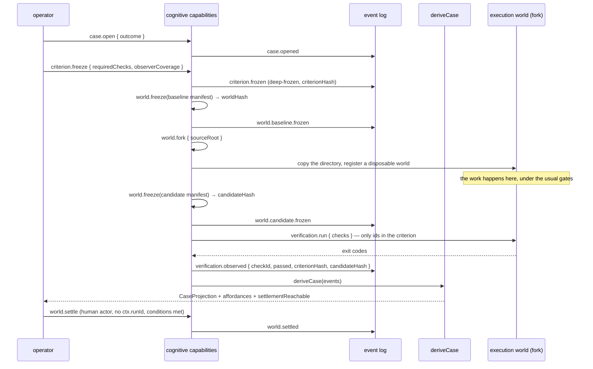

# Workflow: cognitive case settlement

## Summary

The path by which a change becomes real. It is deliberately long: open a Case, freeze what correct
means, record the baseline, fork somewhere disposable, do the work, freeze the candidate, observe it
against the frozen criterion, and settle it with a human decision.

## Sequence

1. **Open the Case.** `case.open` declares the desired difference. A Case has no store of its own;
   `deriveCase` recomputes it from events on every read.
2. **Freeze the criterion.** `criterion.freeze` deep-freezes the evaluation — required check ids,
   consequences, observer coverage — and binds it to a hash. A revision is a new criterion with a new
   hash and requires human authority. This is `executor != evaluator authority`: the thing being
   evaluated does not get to define the evaluation.
3. **Freeze the baseline.** `world.freeze` computes `worldHash` over the consequential manifest
   (workspace file digests, repo SHA, semantic-model / policy / environment hashes, criterion and
   method hashes) and records the baseline lineage event.
4. **Fork.** `world.fork` copies the workspace into a disposable directory and registers it as its own
   execution world id. A candidate never overwrites its settled parent.
5. **Work in the fork.** Normal tools, normal capabilities, normal gates. Lineage, not the directory,
   is the truth.
6. **Freeze the candidate.** `world.freeze` again, this time as a candidate, with the baseline hash as
   its parent.
7. **Observe.** `verification.run` executes the frozen criterion's checks in the candidate world. For
   each check it records an entry bound to **both** the criterion hash and the candidate hash. A check
   not in the frozen criterion throws — you cannot invent evidence after the fact.
   A check passes when `exitCode === 0` and it did not time out.
8. **Derive.** `case.derive` recomputes the `CaseProjection` — deviation, authority, evidence, unknowns,
   affordances, blocked affordances, settlement conditions, `settlementReachable`.
9. **Settle.** `world.settle` promotes the candidate to the settled world. It requires all of:
   - a human actor (`kind: "user"`),
   - no enclosing run (`ctx.runId` must be absent, or it throws),
   - reachable mandatory conditions,
   - a current parent (a stale parent is detected),
   - recorded evidence.

## What the settled world means

Because the manifest excludes lineage metadata, a candidate promoted to settled **keeps the same
`worldHash`** as the candidate it was. Settlement changes the world's status, not its identity. That
is what makes "the settled world is the head every candidate must descend from" a computable
statement rather than a convention.

`repoSha` is a field of the manifest and is not the identity. A commit does not capture what the agent
is reasoning over: policy, criterion, the semantic model and uncommitted files all matter, and the
manifest includes them.

## The affordance field

At each point, `resolveAffordances` returns what is available *now* and what is blocked. The
built-in ladder:

| Operation | Advances | Requires |
|---|---|---|
| … | … | `candidate.exists`, `criterion.frozen` |
| verification | verification | a capability and budget |
| inspect the first failing check | repair | `verification.failed` |
| settle | settlement | `verification.passed`, **human authority** |

Only settlement carries `authority: "human"`. At most one `successor` is shown per affordance, and
payment is omitted rather than zeroed when unknown.

## Bounded search

`experiment.round` runs a hypothesis: apply in a fork, score, optionally check invariants, and judge
the round. Rounds stay bound to the criterion they ran under, and a round is valid only when the apply
and invariant commands both succeed and the score is finite. Each round records a candidate and, if it
is not retained, a rejection.

`method.review` derives candidate method changes from observed residuals, carrying supporting and
contradicting evidence. `method.accept` is human-only and moves the active `methodHash`. Repeated
evidence is not write authority.

## Verification is separate from settlement

`verification.run` is deterministic observation. `world.settle` is a human act. The distinction is
enforced structurally, not by convention, and it is one of the list the spec insists must hold:

```
candidate != settled · execution != settlement · observation != authority
recommendation != decision · settlementReachable != decision to settle
green observer != whole feature proven · repeated evidence != write authority
```

## Cleanup and attention

- Fork directories are disposable; cleanup journeys verify they go away and that the recorded facts
  survive (`test/J-COG-cleanup.test.ts`).
- Focus is ephemeral and never confers authority. `ui_*` and WebMCP tools are read and representation
  only; a mutating action is shown to the human as an `ask` and never executed by the agent.

## Failure branches

| Branch | Behaviour |
|---|---|
| No frozen criterion | `verification.run: no frozen criterion for this case` |
| A check not in the criterion | `verification.run: <id> is not in the frozen criterion` |
| Settle attempted from a run | Throws |
| Settle attempted by a non-user actor | Refused |
| Parent is stale | Detected; promotion refused |
| A lower-trust mediator tries to lower an approval requirement | Sentinel intervenes; the requirement stands |
| Fork provider gone after restart | `world.attach` re-registers an existing directory |

## Sequence diagram



## Source trail

- `src/capabilities/cognitive.ts` — `cognitiveComponent`; `case.open`, `criterion.freeze`,
  `world.freeze`, `world.fork`, `world.attach`, `world.discard`, `verification.run`, `case.derive`,
  `world.settle`, `risk.assess`, `experiment.round`, `method.review`, `method.accept`, `method.active`
- `src/cognitive/world.ts` — `WorldManifest`, `worldHash`, `foldLineage`, `checkPromotion`
- `src/cognitive/case.ts` — `CASE_EVENTS`, `deriveCase`, `reality`, `CaseProjection`
- `src/cognitive/criterion.ts` — `freezeCriterion`, `FrozenCriterion`
- `src/cognitive/affordance.ts` — the resolver and the built-in ladder
- `src/cognitive/experiment.ts`, `method.ts`, `mediation.ts`, `sentinel.ts`, `preflight.ts`
- `src/agents/agentCognitive.ts` — the run that records cognitive facts
- `test/cognitive-semantics.test.ts`, `test/J-COG-*.test.ts`, `test/E2E-cognitive-console.test.ts`
- `.agents/specs/cybernetic-navigation-proof.md` — the design source