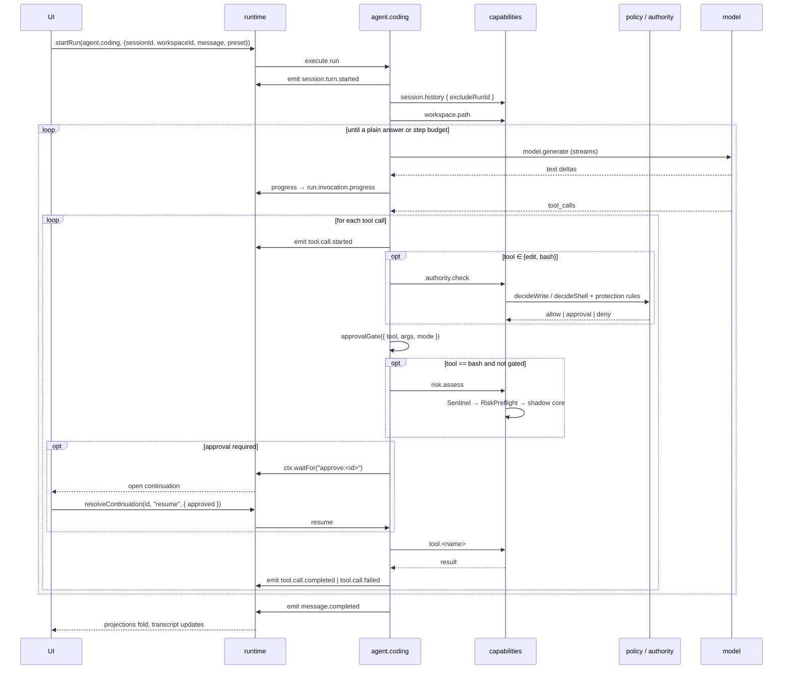

# Workflow: send a turn

The main loop. If you understand this page, you understand the application.

## Summary

The operator types a message and the UI starts one `agent.coding` run. The run reconstructs the
conversation, calls the model, and for each tool call the model returns it runs the four gates, then
invokes the tool capability, then feeds the result back to the model. It repeats until the model
answers in plain text or the step budget is exhausted. Every step is emitted as an event; the
projections fold; the UI updates.

## Sequence

1. The operator sends. The UI calls `startRun({ agent: "agent.coding", input })` with
   `{ sessionId, workspaceId, message, mode?, preset?, caseId?, taskId? }`.
2. The runtime creates the run, correlated `session:<sessionId>`.
3. The agent emits `session.turn.started`, carrying `mode` and `preset` when present — the
   `sessions` projection folds them, which is how the composer's access mode and preset read back.
4. It invokes `plan.state` and branches. `/plan off` is a pure control command: emit
   `plan.mode.changed { on: false }`, emit `message.completed`, return. A leading `/plan ` turns
   plan mode on **without altering the text sent to the model**.
5. It invokes `session.history` with `excludeRunId: ctx.runId` (so the in-flight run's own partial
   events are not fed back in) and `workspace.path` to resolve `(executionWorldId, root)`.
6. It builds the tool catalog: `toolsForPreset(preset, TOOL_DEFS)`, plus the four `UI_TOOL_DEFS`
   when `caseId` is present.
7. It calls `model.generate`. Text deltas stream through `ctx.progress` into
   `run.invocation.progress` events, so the transcript renders live inside the same run.
8. If the model returns tool calls, it processes each in order — see below.
9. When the model answers in plain text, it emits `message.completed` and returns `{ text }`.
10. At `MAX_TOOL_STEPS` (20) the loop ends.

## The per-tool-call sequence

```
emit tool.call.started { sessionId, toolCallId, tool, args }
  ├─ preset check ───────── not in this turn's catalog ─▶ tool.call.failed, feed refusal, continue
  ├─ if tool ∈ {edit, bash}:
  │     invoke authority.check { workspaceId, taskId?, tool, args }
  │       deny     ─▶ [emit workbench.protection.blocked if protected-evidence]
  │       │             tool.call.failed, feed refusal, continue
  │       approval ─▶ remember; may upgrade the decision below
  │       allow    ─▶ continue
  ├─ approvalGate({ tool, args, mode })
  ├─ if taskApproval and not already required ─▶ synthesise an approval decision
  ├─ if tool == bash and not already gated ─▶ invoke risk.assess  (mediation; may require authority)
  ├─ if any gate requires approval:
  │     emit plan.review.requested-style gating, then
  │     ctx.waitFor(`approve:${toolCallId}`, { type: "tool-approval", ... })
  │        resumed by client.resolveContinuation(id, "resume", { approved })
  │        denied ─▶ feed approvalDeniedToolResult, emit tool.call.failed, continue
  ├─ invoke tool.<name> { ...args }
  │     read  ─▶ the workspace's filesystem.readText
  │     edit  ─▶ exact string replace, with a read-before-edit guard for existing files
  │     bash  ─▶ the workspace's process.exec
  │     run_code ─▶ the configured sandbox permission; escalation is what triggers approval
  │     todo_write ─▶ emits plan.todos.updated
  │     exit_plan_mode ─▶ emits plan.review.requested, then a "plan-review" wait
  │     subagent ─▶ invokes subagent.start; on return emits subagent.spawned
  └─ emit tool.call.completed | tool.call.failed
     append { role: "tool", content, toolCallId } to messages
```

Four details that matter:

**`tool.call.started` is emitted before gating, always.** The transcript keys tool entries off this
event, so a pending approval must have a visible tool card to hang its state on. Emitting it after
approval would leave the approval orphaned.

**Refusals are fed back to the model, not thrown.** `Error: blocked by authority (...)` and
`Error: unknown tool "..."` are tool results. The loop continues and the agent can adapt.

**Every disk check that matters is inside `ctx.step`.** The read-before-edit guard is wrapped so it
replays deterministically rather than re-reading a disk that has moved on.

**`readFiles` is the only non-deterministic local state**, and it is a plain `Set` rebuilt
identically on every replay from the same recorded `tool.read` results.

## Model errors and cancellation

A provider failure is classified (`classifyModelFailure`), emitted, and retried with backoff — up to
`MAX_MODEL_RETRIES`, with the base delay overridable by `MODEL_RETRY_BACKOFF_MS`. Exhausting the
retries produces an error surface rather than a silent stop.

Cancellation surfaces as a `status-cancelled` pill with the partial streamed content retained.

## State changes

| Projection | What changes |
|---|---|
| `sessions` | a new turn; the session's current mode and preset; tool and message state |
| `session-trace` | every emitted event, with position |
| `plans` | if plan mode is on, todos and any pending review |
| `subagents` | a row per spawned child |
| `workbench` | if `taskId` is set, usage attributed to the task |
| outbox | intents for `tool.call.*`, `message.completed`, and any observed cognitive event |

## Failure branches

| Branch | Where it surfaces |
|---|---|
| Tool outside the preset | `tool.call.failed` with `Error: unknown tool "<name>"` |
| Authority deny | `tool.call.failed` with `Error: blocked by authority (<rule>): <reason>` |
| Path escapes the workspace | `PathEscapeError` from `tool.read` / `tool.edit` |
| Approval denied | `approvalDeniedToolResult` fed back as a tool result |
| Risk assessment requires authority | the preflight Surface plus an approval wait |
| Model error | classified, retried, then surfaced |
| Step budget exhausted | the run returns without a plain answer |
| Operator cancels | the run stops; partial content stays |

## Sequence diagram



## Source trail

- `src/agents/agentCoding.ts` — the whole loop; `TOOL_DEFS`, `UI_TOOL_DEFS`, `PRESET_TOOLS`,
  `toolsForPreset`, `MAX_TOOL_STEPS`
- `src/capabilities/tools.ts` — `tool.read`, `tool.edit`, `tool.bash`, `tool.run_code`,
  `PathEscapeError`
- `src/capabilities/sessionHistory.ts`, `src/capabilities/workspacePath.ts`
- `src/capabilities/planState.ts`, `src/capabilities/subagentStart.ts`
- `src/domain/approvalGate.ts`, `src/domain/planGate.ts`
- `src/components/modelProvider.ts` — the streaming path
- `src/workbench/authority.ts` — the authority decision
- `test/J-B-basic-session.test.ts`, `test/J-C-tool-execution.test.ts`,
  `test/J-H-cancellation.test.ts`, `test/J-H-provider-error.test.ts`