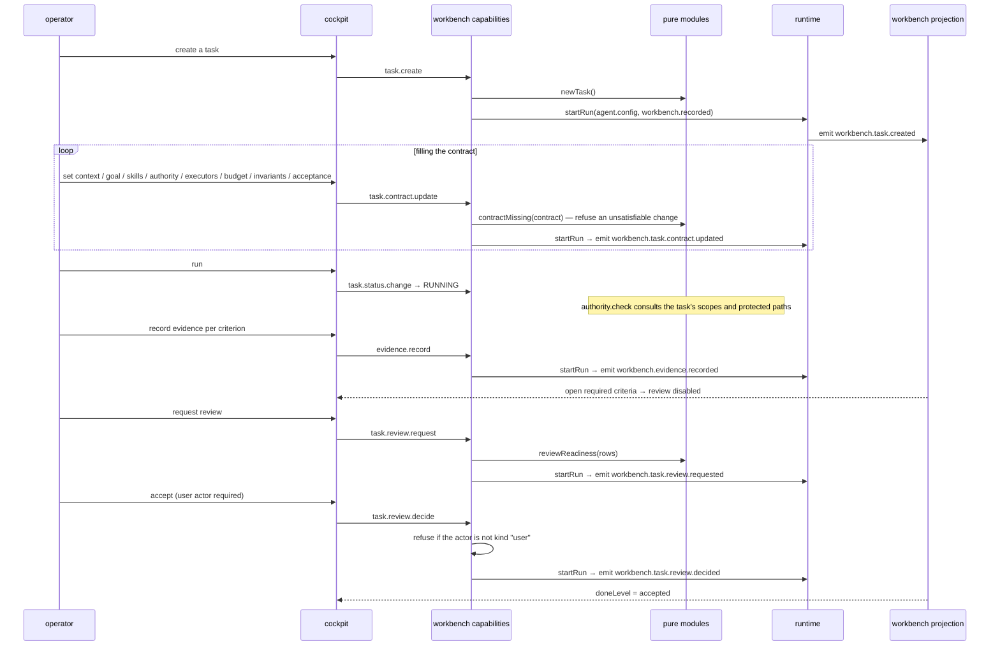

# Workflow: task contract and review

How a unit of agent work is shaped before it runs, and how it is accepted rather than merely
finished.

## Summary

The operator creates a task, fills in a contract, scopes what it may touch, binds executors, sets a
budget, states invariants and acceptance criteria, then runs it. Work records evidence as it goes.
When the required criteria are addressed, the task becomes reviewable, a human decides, and the done
level can reach `accepted` — and then `operationalized`.

## The contract

```ts
interface TaskContract {
  context:    { workspaceId?, files, branch? };
  goal:       { outcome, deliverable?, nonGoals };
  skills:     string[];                 // capability ids
  authority?: AuthorityScopes;
  executors:  ExecutorBinding[];        // { role, executor, kind: "llm" | "deterministic", billingRoute? }
  budget?:    Budget;                   // { maxMs?, maxTokens?, maxCostUsd?, maxConcurrency? }
  invariants: Invariant[];              // { id, kind, statement }
  acceptance: AcceptanceCriterion[];
}
```

`contractMissing()` reports which of the eight `CONTRACT_FIELDS` are unsatisfied:

| Field | Satisfied when |
|---|---|
| `context` | `context.workspaceId` is a non-blank string |
| `goal` | `goal.outcome` is non-blank |
| `skills` | at least one |
| `authority` | defined (not `undefined`) |
| `executors` | at least one |
| `budget` | defined |
| `invariants` | at least one |
| `acceptance` | at least one |

The cockpit renders one chip per field, so the operator can see what is missing without reading the
object.

## Authority scopes

```ts
interface AuthorityScopes {
  filesystem: { read: Grant; write: Grant; outsideWorkspace: Grant };
  shell:     { run: Grant; destructive: Grant };
  network:   Grant;
}
type Grant = "yes" | "approval" | "no";
```

`defaultAuthority()` supplies the app-wide fallback when a task has no scopes. `approval` means the
operation needs a human decision before it runs — see
[Authority and approval](../concepts/authority-and-approval.md).

Protected paths are separate from grants: they are patterns the authority plane enforces
structurally for `edit` and `bash`, at both app and task level.

## The board

```
BACKLOG → BRIEFING → READY → RUNNING → BLOCKED
                       │                  │
                       ▼                  ▼
              READY_FOR_REVIEW ←─────────┘
                       │
                       ▼
              REWORK ──────────▶ RUNNING
                       │
                       ▼
                   ACCEPTED ──▶ OPERATIONALIZED
```

`BLOCKED` and `REWORK` are real states, not decoration. Note: the model defines `BACKLOG` and
`BLOCKED`, but no UI action currently sets them — recorded in [Known gaps](../known-gaps.md).

## Evidence during the run

While the task runs, `usage.record` attributes calls to executors (model, tool, verification, retry),
and `evidence.record` writes entries against acceptance criteria.

`ledgerRows` groups the criteria into `closed` / `failed` / `open`; the cockpit renders acceptance
criteria and evidence together because they answer one question: *what must stay true, and what is
proven?*

## Review

`reviewReadiness` computes whether the required criteria are addressed. When it passes, the cockpit
enables the review request.

`task.review.request` opens the gate. `task.review.decide` accepts or requests changes — and it
**requires a `user` actor**. An agent run invokes capabilities as a non-user principal, so it cannot
accept its own work. `REWORK` sends it back with `worker.return` recorded.

`doneLevel` then advances. `accepted` is a human decision; `operationalized` means the result
compounds — a seeded capability, a skill, an automation.

## Workflows

A `WorkflowDefinition` is a graph whose nodes advance under two edge kinds:

- `needs` — the target node must pass this one
- `after` — the target node must see this one settle

`nextTransitions` returns the legal moves with their `evidenceRequired` kinds and optional `guard`.
`readyNodes` computes what is available now. Advancement is explicit: a green neighbour does not
silently advance anything.

## Skills and capabilities

The catalog is seeded (`workbench.seed`, `seedCatalog`, `seedBindings`). A skill moves through
`CAPABILITY_LIFECYCLE` one step at a time via `skill.lifecycle.advance`; `advanceLifecycle` refuses a
skip. `skill.bind` checks substitution compatibility (`checkSubstitution`) and conflicts
(`detectConflicts`) rather than overwriting a binding blindly.

## Sequence



## State changes

All of it lands in the `workbench` projection through `workbench.*` events:
`workbench.task.created`, `workbench.task.contract.updated`, `workbench.task.status.changed`,
`workbench.evidence.recorded`, `workbench.task.review.requested`, `workbench.task.review.decided`,
`workbench.workflow.*`, `workbench.skill.*`, `workbench.automation.*`, `workbench.usage.recorded`,
`workbench.protection.blocked`, `workbench.steer.*`, `workbench.feedback.recorded`.

## Failure branches

| Branch | Behaviour |
|---|---|
| Contract change refused | `contractMissing` names the offending field |
| Evidence recorded against an unknown criterion | Refused |
| An agent tries to decide the review | Refused: not a `user` actor |
| A protected path is written | `workbench.protection.blocked` recorded with path and pattern |
| A workflow node will not advance | Missing evidence, or an unmet `needs` edge; `nextTransitions` says which |
| A capability cannot skip a lifecycle step | `advanceLifecycle` refuses |

## Source trail

- `src/workbench/types.ts` — `TaskContract`, `CONTRACT_FIELDS`, `AuthorityScopes`, `Grant`, `Budget`,
  `Invariant`, `AcceptanceCriterion`, `ExecutorBinding`, `TaskStatus`, `DoneLevel`, `WORKBENCH_EVENTS`
- `src/workbench/contract.ts` — `contractMissing`, `contractChips`
- `src/workbench/authority.ts` — `decideWrite`, `decideShell`, `defaultAuthority`
- `src/workbench/ledger.ts` — `ledgerRows`, `groupLedger`, `openRequired`, `acceptanceReady`,
  `reviewReadiness`, `doneLevel`
- `src/workbench/workflow.ts` — `validateWorkflow`, `readyNodes`, `nextTransitions`, `nodeDone`
- `src/workbench/skillOs.ts` — `seedCatalog`, `seedBindings`, `advanceLifecycle`, `checkSubstitution`,
  `detectConflicts`
- `src/capabilities/workbench.ts` — `WORKBENCH_CAPABILITY_IDS`, the human-only actor check
- `src/workbench/reducer.ts` — the fold
- `src/ui/workbench/` — `ContractBar`, `ContractEditor`, `AuthorityPlane`, `LedgerPanel`,
  `DoneLadder`, `ReviewCard`, `WorkerReturnForm`, `TaskList`, `WorkflowGraph`, `NodeInspector`,
  `CapabilityList`, `AutomationPanel`, `Workbench.tsx`
- `test/J-WB-task-contract.test.ts`, `test/J-WB-review-gate.test.ts`,
  `test/J-WB-protected-evidence.test.ts`, `test/J-WB-workflow.test.ts`,
  `test/J-WB-parallelism.test.ts`, `test/J-WB-economics.test.ts`, `test/J-WB-automation.test.ts`,
  `test/E2E-workbench.test.ts`
- `.agents/plans/unified_harness_experience_model_v2.md` — the design source